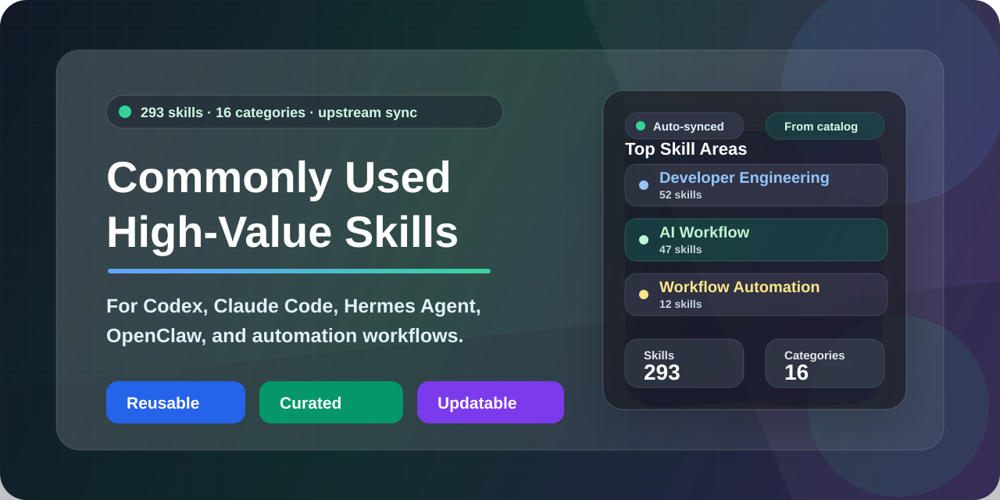

# Commonly Used High-Value Skills



[](./README.md)
[](./README.en.md)
[](./openclaw-skills/README.md)
[](./skills/)
[](./LICENSE)

A high-value skills repository for AI developers and agent workflow builders worldwide: ready-to-use skills (`SKILL.md` plus scripts and references) organized by real work scenarios across developer engineering, DevOps, product design, operations, office automation, finance, AI platforms, and security. One source tree works with `Codex`, `Claude Code`, `Cursor`, `Hermes Agent`, and `OpenClaw`, and every skill has provenance tracking, a license audit, and automated quality checks. This repository currently contains **16 categories / 293 skills**.

[Quick Start](#quick-start) · [Categories](#categories) · [Skill Overview](#skill-overview) · [Contributing](#contributing) · [Releases](docs/RELEASES.en.md)

## Why It Is Useful

- **High-frequency skills, organized by scenario**: stop hunting for prompts, scripts, and workflows; use it for daily lookup or as a base your team extends.
- **More than documentation**: many skills ship `scripts/`, `references/`, and `assets/` you can reuse directly.
- **One source, many clients**: works with `Codex`, `Claude Code`, `Cursor`, `Antigravity`, `Hermes Agent`, and `OpenClaw`, with a one-command `npx` installer.
- **Maintained, not just collected**: discovery of new skills, upstream sync, candidate ranking, quality gates, and generated views run as one loop; a policy file manages allowed, denied, and preferred sources plus admission thresholds.
- **Trustworthy and traceable**: every skill has a provenance record; external skills must pass a license audit; releases require passing CI and zero open Code Scanning alerts; the monthly `dead-links` workflow checks external links.
- **Built-in security review**: `skill-security-auditor`, `security-review`, `input-guard`, and `link-checker` help spot risks before you install third-party skills.
- **First-class Hermes Agent support**: includes `hermes-agent`, `native-mcp`, and the thin `hermes-open-gsd-workflow` router.

## Who This Is For

- AI developers, agent workflow builders, and automation tool users
- Individuals and teams who want to turn recurring tasks into skills
- Engineers using `Codex`, `Claude Code`, `Cursor`, `Hermes Agent`, `OpenClaw`, and similar tools
- Anyone building their own library of high-value skills, prompts, or agent workflows

<a id="quick-start"></a>
## Quick Start

### Which Directory Should You Use

| Client / scenario | Directory | Notes |
|-------------------|-----------|-------|
| Let `Codex` / `Claude Code` / `Hermes Agent` / `Cursor` browse the repository source | `skills/` | Keeps the category structure for search, maintenance, and editing |
| Local `Codex` install | `~/.codex/skills` | Flat install via the npx installer or the sync script, so the client can discover skills |
| Local `Claude Code` install | `~/.claude/skills` or project `.claude/skills` | Same as above |
| `OpenClaw` | `openclaw-skills/` | OpenClaw only reads a flat, one-level directory; do not point it at the repository root or `skills/` |

### Option 1: Install With npx (recommended for command-line users)

If you don't want to clone and copy directories by hand, run the installer straight from GitHub:

```bash
npx github:seaworld008/Commonly-used-high-value-skills install
```

By default this installs into the current project's `.agents/skills`, which many tools that follow the Agent Skills convention can read. You can also install into several client directories at once:

```bash
# Preview first: list the directories and skills that would be written, without changing anything
npx github:seaworld008/Commonly-used-high-value-skills install --target codex,claude --dry-run

# Install into the Codex and Claude Code user-level skills directories
npx github:seaworld008/Commonly-used-high-value-skills install --target codex,claude

# Install only selected categories to reduce default context and maintenance surface
npx github:seaworld008/Commonly-used-high-value-skills install --target codex --category developer-engineering,security-and-reliability

# Install only the skills you need; combine with --category to take the intersection
npx github:seaworld008/Commonly-used-high-value-skills install --target codex --skill docx,xlsx,pdf,pptx

# Install into a custom directory for another AI agent client
npx github:seaworld008/Commonly-used-high-value-skills install --target custom --dir ./vendor/agent-skills

# Pin a release so your team gets reproducible installs
npx github:seaworld008/Commonly-used-high-value-skills#v6.0.0 install --target codex

# Browse available skills, categories, and install targets
npx github:seaworld008/Commonly-used-high-value-skills list-skills
npx github:seaworld008/Commonly-used-high-value-skills list-targets
```

Available targets:

| Target | Install directory |
|--------|-------------------|
| `agents-project` | `./.agents/skills` (default) |
| `codex` | `~/.codex/skills` |
| `claude` | `~/.claude/skills` |
| `claude-project` | `./.claude/skills` |
| `cursor` | `~/.cursor/skills` |
| `antigravity` | `~/.gemini/antigravity/skills` |
| `openclaw` | `~/.openclaw/skills`; a local clone prefers `openclaw-skills/`, while the npx package installs flat from `skills/` |
| `custom` | Set with `--dir` |

Installer safety guarantees:

- `--dry-run` only computes and prints the install plan; it writes nothing.
- `--all` means every standard client target and is not a recommended default; pick `--target`, `--category`, and `--skill` as needed.
- When upgrading from an older version, use `--prune-retired` to clean up retired skills: it deletes only unchanged copies this installer owns and archives everything else.
- Each target directory gets a `.high-value-skills-manifest.json` with source and file digests. Replacements are staged and verified first, and modified or unowned copies are archived in `.high-value-skills-backups/` next to the destination.
- This is not one atomic transaction across all targets: if something fails, check the output and the backup directory rather than deleting old copies by hand.

If you already use the `skills.sh` ecosystem, you can also try the standard entry point:

```bash
npx skills add seaworld008/Commonly-used-high-value-skills --all -a codex -a claude-code --copy
```

The repository's own `high-value-skills` installer is the better fit when you need explicit Codex / Claude / Cursor / OpenClaw / custom directory selection.

### Option 2: Give This Prompt to Your AI Tool

If you want your AI tool to install the skills for you, start with this short prompt:

```text
You are my local installation assistant. Install the skills from https://github.com/seaworld008/Commonly-used-high-value-skills into this AI tool.
```

If the tool doesn't figure out the details on its own, add one more line:

```text
The current tool is `<Codex / Claude Code / Hermes Agent / Cursor / OpenClaw>`, and the local repository path is `<your local repository path>`.
```

This short prompt is enough because the repository already contains installation rules and directory conventions written for AI tools ([AGENTS.md](./AGENTS.md)), so you rarely need to spell out the installation logic yourself.

### Option 3: Manual Setup

1. Clone the repository and enter it:

```bash
git clone https://github.com/seaworld008/Commonly-used-high-value-skills.git
cd Commonly-used-high-value-skills
```

2. If you use `Codex`, sync into the local Codex skills directory:

```bash
python3 scripts/sync_codex_skills.py --source-root ./skills --codex-root ~/.codex/skills
```

Windows PowerShell example:

```powershell
python scripts/sync_codex_skills.py --source-root ".\skills" --codex-root "$env:USERPROFILE\.codex\skills"
```

3. If you use `Claude Code`, sync into a personal or project-level skills directory:

```bash
# Personal: available in every project
python3 scripts/sync_codex_skills.py --source-root ./skills --codex-root ~/.claude/skills

# Project: available only in the current project
python3 scripts/sync_codex_skills.py --source-root ./skills --codex-root ./.claude/skills
```

Windows PowerShell example:

```powershell
python scripts/sync_codex_skills.py --source-root ".\skills" --codex-root "$env:USERPROFILE\.claude\skills"
```

`--codex-root` is a legacy parameter name; it simply means "target skills directory" and can point at `Claude Code` or any other client's skills directory.

4. If you use `Hermes Agent`, `Cursor`, or another AI coding assistant that can browse source directories, point it at the repository's `skills/` first. If the tool needs a flat, one-level skills directory, reuse the sync command above and set `--codex-root` to that tool's skills directory.

5. If you use `OpenClaw`, generate the flat export first:

```bash
python3 scripts/export_openclaw_skills.py
```

Then add `openclaw-skills/` to `skills.load.extraDirs` in your OpenClaw configuration (do not point it at the repository root or `skills/`), and confirm the skills are detected:

```bash
openclaw skills list
openclaw skills check
```

6. Spot-check a few skill directories, for example:
   - `skills/developer-engineering/codebase-onboarding`
   - `skills/security-and-reliability/skill-security-auditor`
   - `openclaw-skills/codebase-onboarding`

More client-specific installation examples:

- [Client installation guides](./docs/client-install-guides.md)
- [nlpm-audit usage guide](./docs/nlpm-audit-usage.md): how it triggers automatically after installing into `Codex` / `Claude Code` / `OpenClaw`, how to invoke it explicitly, generate Markdown audit reports, and keep it updated.

<a id="categories"></a>
## Quick Category Jump Table

| Category | Description | Jump | Directory |
|----------|-------------|------|-----------|
| Developer Engineering | Development, testing, performance, code review, databases, and architecture | [Jump](#cat-developer-engineering) | [Open](./skills/developer-engineering/) |
| AI Workflow | Agent skill usage, planning, implementation, review, verification, and release loops | [Jump](#cat-ai-workflow) | [Open](./skills/ai-workflow/) |
| AI Platform and Agent Development | ChatGPT Apps, Hermes, MCP, Figma, OpenAI Docs, and autonomous agents | [Jump](#cat-ai-agent-platform) | [Open](./skills/ai-agent-platform/) |
| Engineering Workflow Automation | Browser automation, GitHub, notebooks, Playwright, graphify/GSD | [Jump](#cat-workflow-automation) | [Open](./skills/engineering-workflow-automation/) |
| DevOps / SRE | Releases, monitoring, incident response, CI/CD, environment management | [Jump](#cat-devops-sre) | [Open](./skills/devops-sre/) |
| Finance and Investing | Financial data, valuation, risk, backtesting, research writing | [Jump](#cat-finance-investing) | [Open](./skills/finance-investing/) |
| Growth Operations | Xiaohongshu, social media, content, attribution, competitor analysis | [Jump](#cat-growth-operations) | [Open](./skills/growth-operations-xiaohongshu/) |
| Office and Documents | Word, Excel, PowerPoint, PDF, meeting minutes | [Jump](#cat-office-white-collar) | [Open](./skills/office-white-collar/) |
| Knowledge and PM Integrations | Notion, Linear, Obsidian, Feishu/Lark, spec-to-implementation | [Jump](#cat-knowledge-pm) | [Open](./skills/knowledge-and-pm-integrations/) |
| General Operations | Brand, fact checking, internal communications, themes, and weather | [Jump](#cat-operations-general) | [Open](./skills/operations-general/) |
| Product and Design | Product analysis, design systems, UX research, SaaS scaffolding | [Jump](#cat-product-design) | [Open](./skills/product-design/) |
| Security and Reliability | Sentry, security best practices, threat modeling, vulnerability scanning | [Jump](#cat-security-reliability) | [Open](./skills/security-and-reliability/) |
| Multimodal Media | Images, speech, video, screenshots, summaries, transcription | [Jump](#cat-multimodal-media) | [Open](./skills/multimodal-media/) |
| Deployment Platforms | Cloudflare, Netlify, Render, Vercel | [Jump](#cat-deployment-platforms) | [Open](./skills/deployment-platforms/) |
| Memory and Safety | Long-term memory, input guarding, RAG, runbooks | [Jump](#cat-memory-safety) | [Open](./skills/openclaw-memory-and-safety/) |
| Task Understanding and Decomposition | Web research, retrospectives, and task-understanding support | [Jump](#cat-task-understanding) | [Open](./skills/task-understanding-decomposition/) |

## Where to Start

If this is your first visit, start with the Developer Engineering, AI Workflow, AI Platform and Agent Development, and Security and Reliability categories, or try these representative skills:

- `codebase-onboarding`: quickly understand a codebase's structure, tech stack, key modules, and onboarding path.
- `context-engineering`: diagnose missing or overloaded context and configure project-level agent instructions.
- `agent-workflow-designer`: design multi-step agent workflows, role splits, and execution loops.
- `gh-fix-ci`: find why GitHub Actions failed and fix the CI pipeline.
- `financial-data-collector`: collect stock, filing, market, and macro financial data.
- `notion-spec-to-implementation`: turn a Notion spec into actionable implementation tasks.
- `transcribe`: transcribe audio or video into text with speakers and timestamps.
- `skill-security-auditor`: before installing or updating third-party skills, scan statically and manually review permissions, dependencies, and source risks.
- `github-ops`: handle PRs, issues, reviews, releases, and Actions through `gh`.

## Hermes Agent Support

`Hermes Agent` is one of this repository's officially supported clients, not just a client that happens to have a few related skills:

- Browse the source through `skills/`; for local `Codex` / `Claude Code` installs, sync into each client's skills directory.
- [`hermes-agent`](./skills/ai-agent-platform/hermes-agent/): synced with official upstream releases; covers the CLI, gateway, profiles, memory, skills, MCP, and contributor guidance.
- [`native-mcp`](./skills/ai-agent-platform/native-mcp/): helps Hermes connect to external MCP servers.
- [`hermes-open-gsd-workflow`](./skills/ai-agent-platform/hermes-open-gsd-workflow/): a thin router that picks Hermes, Graphify, Open GSD Core, or the explicitly optional GSD Pi per request.

Hermes users should start with [`skills/ai-agent-platform/README.md`](./skills/ai-agent-platform/README.md) and the [client installation guides](./docs/client-install-guides.md).

### Hermes, Graphify, and Open GSD

The repository includes the official Hermes artifact set and a curated Graphify entry that keeps the complete official references, and manages Open GSD Core / Pi as governed bundles. The local composition layer keeps only one entry, `hermes-open-gsd-workflow`, and does not copy versions, install commands, or state machines. Actual versions, integrity digests, installers, and inventories come from the canonical provenance and bundle metadata in [`docs/sources/`](./docs/sources/). The old Hermes + Graphify + GSD composite skills and their migration shims have been removed; the portfolio denylist only prevents those old names from being reintroduced.

## GPT-6 Astra Instruction Improvements

Skills use concise triggers, on-demand references, and risk-based verification. The full audit notes, official sources, and model-evaluation boundaries are in the [Astra guidance](docs/astra-skill-guidance.md); day-to-day maintenance follows the [unified workflow](docs/maintenance-workflow.md). Repository updates are managed separately from local model configuration and skill installation. Shared formats, host differences, and verification boundaries for Codex / Claude are in the [cross-agent compatibility notes](docs/cross-agent-compatibility.md).

## Directory Structure

```text
skills/
  developer-engineering/                # Developer engineering
  ai-workflow/                          # AI workflow (agent skills / context engineering / plan execution)
  ai-agent-platform/                    # AI platform and agent development
  engineering-workflow-automation/      # Engineering workflow automation (GitHub/CI/testing)
  devops-sre/                           # DevOps / SRE
  finance-investing/                    # Finance and investment research
  growth-operations-xiaohongshu/        # Growth operations (Xiaohongshu/social media)
  office-white-collar/                  # Office and document productivity
  knowledge-and-pm-integrations/        # Knowledge and PM integrations (Linear/Notion/Obsidian/Feishu)
  operations-general/                   # General operations
  product-design/                       # Product and design
  security-and-reliability/             # Security and reliability
  multimodal-media/                     # Multimodal media (image/speech/video/transcription)
  deployment-platforms/                 # Deployment platforms (Vercel/Netlify/Render/Cloudflare)
  openclaw-memory-and-safety/           # Memory and safety
  task-understanding-decomposition/     # Task understanding and decomposition
openclaw-skills/                        # Generated flat export for OpenClaw (do not edit by hand)
docs/                                   # Maintenance docs, release notes, provenance records, generated catalog
scripts/                                # Install, sync, generation, and validation scripts
```

## Usage

1. Open a category directory (for example `skills/developer-engineering/`), or click a skill name in the overview below.
2. Read that skill's `SKILL.md` for its triggers, workflow, boundaries, and script notes.
3. If the skill includes `scripts/`, `references/`, or `assets/`, reuse them first.

Quick search:

```bash
# List all skill definition files
rg --files skills -g SKILL.md

# Search skills by keyword
rg -n -g SKILL.md "prompt|security|pdf|deploy" skills
```

<a id="skill-overview"></a>
## Skill Overview (by category, 16 categories / 293 skills)

<a id="cat-developer-engineering"></a>
### 1. Developer Engineering (developer-engineering, 52)

- [`agent-designer`](./skills/developer-engineering/agent-designer/): Design AI agent responsibilities, tools, memory, orchestration, and evaluation when defining an agent architecture or system contract.
- [`api-design-reviewer`](./skills/developer-engineering/api-design-reviewer/): Use when reviewing API designs for consistency, usability, versioning, error semantics, security, backward compatibility, and developer experience before implementation or release.
- [`api-test-suite-builder`](./skills/developer-engineering/api-test-suite-builder/): Generate API tests from routes and contracts for authentication, validation, pagination, errors, uploads, and limits in Node.js or Python projects.
- [`aws-solution-architect`](./skills/developer-engineering/aws-solution-architect/): Design or review AWS architecture and infrastructure as code for serverless systems, migrations, scaling, reliability, and cost constraints.
- [`builder`](./skills/developer-engineering/builder/): Use when implementing production business logic: type-safe domain models, validated boundaries, resilient API integrations, and CQRS or event sourcing in TypeScript, Go, Python, or Rust.
- [`cli-demo-generator`](./skills/developer-engineering/cli-demo-generator/): Create terminal recordings and animated CLI demo GIFs from command workflows or VHS tape files.
- [`codebase-inspection`](./skills/developer-engineering/codebase-inspection/): Use when a user needs reproducible repository sizing, language composition, file counts, or code-versus-comment ratios with pygount; record exclusions and verify measurement scope before interpreting results.
- [`codebase-onboarding`](./skills/developer-engineering/codebase-onboarding/): Create repository onboarding guides with architecture, key files, setup, debugging, and contribution workflows for a defined audience.
- [`database-designer`](./skills/developer-engineering/database-designer/): Design, review, or migrate database schemas using workload requirements, data integrity, query plans, and operational constraints.
- [`database-schema-designer`](./skills/developer-engineering/database-schema-designer/): Design relational database schemas from requirements and generate migrations, TypeScript/Python types, seed data, RLS policies, and indexes. Handles multi-tenancy, soft deletes, audit trails, versioning, and polymorphic associations.
- [`dependency-auditor`](./skills/developer-engineering/dependency-auditor/): Audit dependency inventories, verify vulnerability and license evidence, and plan tested upgrades for an existing project.
- [`docker-expert`](./skills/developer-engineering/docker-expert/): Use when containerizing an application with Docker, optimizing multi-stage builds and image size, designing Docker Compose services, troubleshooting container networking or volumes, or adding secure image build and CI/CD practices.
- [`frontend-design`](./skills/developer-engineering/frontend-design/): Design and implement polished web components, pages, and applications with a coherent visual direction and usable interaction states.
- [`gateway`](./skills/developer-engineering/gateway/): Use when designing or reviewing REST or GraphQL APIs: OpenAPI specs, versioning and deprecation, breaking-change detection, RFC 9457 error bodies, and API security.
- [`git-worktree-manager`](./skills/developer-engineering/git-worktree-manager/): Create, inspect, and clean up Git worktrees for parallel development, with explicit ownership, environment handling, and port allocation.
- [`github-contributor`](./skills/developer-engineering/github-contributor/): Find suitable open-source contribution opportunities and prepare focused GitHub pull requests with project-specific validation and review context.
- [`golang-benchmark`](./skills/developer-engineering/golang-benchmark/): Run reproducible Go benchmarks, profiling, benchstat and CI regression analysis.
- [`golang-performance`](./skills/developer-engineering/golang-performance/): Optimize Go hot paths after profiling allocations, CPU, GC, caching and I/O.
- [`graphify`](./skills/developer-engineering/graphify/): Build, query, or refresh Graphify knowledge graphs for code and documents when graph-based relationship analysis is useful or explicitly requested.
- [`graphql-expert`](./skills/developer-engineering/graphql-expert/): Use when designing GraphQL APIs, reviewing schemas and resolvers, optimizing queries, managing federation, or checking GraphQL security and performance best practices.
- [`i18n-expert`](./skills/developer-engineering/i18n-expert/): Implement or audit UI internationalization: translation keys, locale files, pluralization, formatting, hard-coded strings, and parity checks.
- [`improve-codebase-architecture`](./skills/developer-engineering/improve-codebase-architecture/): Review module boundaries, interface depth and high-leverage refactors with evidence.
- [`kubernetes-specialist`](./skills/developer-engineering/kubernetes-specialist/): Use when managing Kubernetes clusters, debugging Pods and workloads, designing Helm charts, reviewing manifests, or improving deployment, scaling, and observability practices.
- [`mcp-builder`](./skills/developer-engineering/mcp-builder/): Build MCP servers that expose external APIs or services through well-scoped tools in Python or TypeScript.
- [`migration-architect`](./skills/developer-engineering/migration-architect/): Purpose: Zero-downtime migration planning, compatibility validation, and rollback strategy generation.
- [`monorepo-navigator`](./skills/developer-engineering/monorepo-navigator/): Inspect or improve Turborepo, Nx, pnpm, or Lerna monorepos: package boundaries, dependency graphs, selective tests, caching, and migrations.
- [`neon-postgres`](./skills/developer-engineering/neon-postgres/): Build or troubleshoot Neon Postgres connections, branching, pooling, scaling, Auth, and platform integrations using current Neon documentation.
- [`nextjs-app-router`](./skills/developer-engineering/nextjs-app-router/): Master Next.js 14+ App Router with Server Components, streaming, parallel routes, and advanced data fetching. Use when building Next.js applications, implementing SSR/SSG, or optimizing React Server Components.
- [`performance-profiler`](./skills/developer-engineering/performance-profiler/): Profile Node.js, Python, or Go CPU, memory, I/O, and query bottlenecks; use flamegraphs and representative load tests to verify improvements.
- [`pr-review-expert`](./skills/developer-engineering/pr-review-expert/): Review GitHub PRs or GitLab MRs for correctness, security, compatibility, and affected test coverage, with actionable evidence tied to the diff.
- [`prisma-client-api`](./skills/developer-engineering/prisma-client-api/): Use when writing or reviewing Prisma Client queries, relation writes, transaction boundaries, filters, pagination, or raw SQL in a Prisma project.
- [`prisma-upgrade-v7`](./skills/developer-engineering/prisma-upgrade-v7/): Use when migrating an existing Prisma ORM SQL project from v6 to v7, updating generated-client imports, driver adapters, module format, or configuration.
- [`promptfoo-evaluation`](./skills/developer-engineering/promptfoo-evaluation/): Configure and run Promptfoo evaluations, assertions, rubrics, and datasets when testing LLM prompts or comparing model behavior.
- [`python-performance`](./skills/developer-engineering/python-performance/): Profile and optimize Python code using cProfile, memory profilers, and performance best practices. Use when debugging slow Python code, optimizing bottlenecks, or improving application performance.
- [`qa-expert`](./skills/developer-engineering/qa-expert/): Design QA strategies, risk-based test cases, execution plans, and defect reports when establishing or improving software quality assurance.
- [`react-native-engineering`](./skills/developer-engineering/react-native-engineering/): Build, debug, upgrade, or ship React Native and Expo apps, including navigation, native modules, iOS/Android differences, performance, and EAS delivery.
- [`repomix-safe-mixer`](./skills/developer-engineering/repomix-safe-mixer/): Scan for hardcoded credentials, report redacted findings, and block repomix packaging when risks are found. Use when packaging code for distribution, creating reference packages, or checking credentials before sharing a codebase.
- [`rust-engineer`](./skills/developer-engineering/rust-engineer/): Use when writing or reviewing Rust code, designing safe APIs, debugging ownership and lifetimes, choosing async patterns, or improving systems-level performance.
- [`schema`](./skills/developer-engineering/schema/): Use when designing or reviewing database schemas: data models, zero-downtime migrations, index strategy, multi-tenant isolation, and pgvector or temporal tables.
- [`shadcn`](./skills/developer-engineering/shadcn/): Use when adding, updating, debugging, or composing shadcn/ui components, registries, themes, or presets in a project that uses shadcn.
- [`skill-tester`](./skills/developer-engineering/skill-tester/): Validate skill structure, bundled scripts and expected outputs against the target repository and agent host requirements.
- [`supabase`](./skills/developer-engineering/supabase/): Build or troubleshoot Supabase Database, Auth, Storage, Realtime, Edge Functions, and client/SSR integrations; use current platform documentation.
- [`supabase-postgres-best-practices`](./skills/developer-engineering/supabase-postgres-best-practices/): Use when writing or reviewing Postgres schemas, queries, indexes, RLS policies, connection settings, or migrations with Supabase guidance; applicable to Postgres on any hosting platform.
- [`systematic-debugging`](./skills/developer-engineering/systematic-debugging/): Use when encountering any bug, test failure, or unexpected behavior, before proposing fixes.
- [`tailwind-design-system`](./skills/developer-engineering/tailwind-design-system/): Build scalable design systems with Tailwind CSS v4, design tokens, component libraries, and responsive patterns. Use when creating component libraries, implementing design systems, or standardizing UI patterns.
- [`tech-debt-tracker`](./skills/developer-engineering/tech-debt-tracker/): Identify technical debt, rank remediation by impact and effort, and track progress using code and maintenance evidence.
- [`terraform-engineer`](./skills/developer-engineering/terraform-engineer/): Use when designing Terraform IaC, reviewing modules, managing state, planning provider upgrades, or improving repeatable infrastructure deployment workflows.
- [`typescript-best-practices`](./skills/developer-engineering/typescript-best-practices/): Use when writing or reviewing TypeScript for type safety, advanced types, API boundaries, strict-mode migrations, and common anti-pattern avoidance.
- [`vercel-react-best-practices`](./skills/developer-engineering/vercel-react-best-practices/): Optimize React and Next.js rendering, data fetching, bundles, and runtime performance using Vercel's engineering guidance.
- [`vercel-react-view-transitions`](./skills/developer-engineering/vercel-react-view-transitions/): Implement React ViewTransition animations, navigation transitions, transition types, and CSS pseudo-elements using the target React version's API.
- [`web-artifacts-builder`](./skills/developer-engineering/web-artifacts-builder/): Build complex interactive HTML artifacts with React, Tailwind, and shadcn/ui when multiple components, routing, or state are needed.
- [`webapp-testing`](./skills/developer-engineering/webapp-testing/): Use when testing local web applications with Playwright, verifying frontend behavior, debugging UI issues, capturing screenshots, inspecting browser logs, or validating user flows.

<a id="cat-ai-workflow"></a>
### 2. AI Workflow (ai-workflow, 47)

- [`agent-workflow-designer`](./skills/ai-workflow/agent-workflow-designer/): Design agent orchestration, handoffs, state, recovery, and evaluation when a workflow needs multiple coordinated agents or tools.
- [`andrej-karpathy-skills`](./skills/ai-workflow/andrej-karpathy-skills/): Karpathy-inspired coding discipline for AI agents: think before coding, keep changes simple, edit surgically, and define verifiable success criteria before implementation.
- [`api-and-interface-design`](./skills/ai-workflow/api-and-interface-design/): Design REST/GraphQL APIs, module interfaces, and type contracts when creating endpoints or changing public boundaries.
- [`brainstorming`](./skills/ai-workflow/brainstorming/): Use before creative product or engineering work when the user wants to design a feature, component, workflow, behavior change, or other solution whose goals, constraints, and tradeoffs need exploration before implementation.
- [`browser-testing-with-devtools`](./skills/ai-workflow/browser-testing-with-devtools/): Inspect browser DOM, network, console, screenshots, and performance with Chrome DevTools MCP when validating or debugging web behavior.
- [`ci-cd-and-automation`](./skills/ai-workflow/ci-cd-and-automation/): Automates CI/CD pipeline setup. Use when setting up or modifying build and deployment pipelines. Use when you need to automate quality gates, configure test runners in CI, or establish deployment strategies.
- [`code-review-and-quality`](./skills/ai-workflow/code-review-and-quality/): Review a diff, pull request, or pasted code for correctness, regressions, security, maintainability, and missing tests.
- [`code-simplification`](./skills/ai-workflow/code-simplification/): Refactor working code for clarity and maintainability while preserving behavior; use when complexity or duplication obstructs changes.
- [`context-engineering`](./skills/ai-workflow/context-engineering/): Diagnose missing or overloaded agent context and configure project instructions when setup or context quality is the task.
- [`debugging-and-error-recovery`](./skills/ai-workflow/debugging-and-error-recovery/): Diagnose failing tests, broken builds, and unexpected runtime behavior through reproduction, evidence, root-cause analysis, and focused recovery.
- [`deep-research`](./skills/ai-workflow/deep-research/): Produce source-backed research reports, literature reviews, or technical and market briefs when evidence tracking and a defined report format matter.
- [`deprecation-and-migration`](./skills/ai-workflow/deprecation-and-migration/): Plan deprecation and migration of systems, APIs, and production schemas, including expand-contract changes with compatibility and rollback requirements.
- [`dispatching-parallel-agents`](./skills/ai-workflow/dispatching-parallel-agents/): Use when facing 2+ independent tasks that can be worked on without shared state or sequential dependencies.
- [`documentation-and-adrs`](./skills/ai-workflow/documentation-and-adrs/): Records decisions and documentation. Use when making architectural decisions, changing public APIs, shipping features, or when you need to record context that future engineers and agents will need to understand the codebase.
- [`doubt-driven-development`](./skills/ai-workflow/doubt-driven-development/): Review high-risk or uncertain engineering decisions adversarially when independent verification can expose costly assumptions before implementation.
- [`executing-plans`](./skills/ai-workflow/executing-plans/): Use when executing an existing implementation plan, tracking dependencies, adapting outdated steps, and verifying acceptance checks.
- [`find-skills`](./skills/ai-workflow/find-skills/): Use when users do not know which skill fits a task, need to search installed skills or public skill catalogs, compare candidates, or decide whether to install one.
- [`finishing-a-development-branch`](./skills/ai-workflow/finishing-a-development-branch/): Use when implementation is complete, all tests pass, and you need to decide how to integrate the work.
- [`frontend-ui-engineering`](./skills/ai-workflow/frontend-ui-engineering/): Build accessible, responsive interfaces and components with production UI states, project conventions, and browser validation.
- [`git-workflow-and-versioning`](./skills/ai-workflow/git-workflow-and-versioning/): Manage branches, commits, conflicts, semantic versions, and changelogs when preparing Git changes or releases.
- [`idea-refine`](./skills/ai-workflow/idea-refine/): Explore alternatives and stress-test assumptions when refining a vague idea into a concrete concept or evaluating an early plan.
- [`incremental-implementation`](./skills/ai-workflow/incremental-implementation/): Delivers changes incrementally. Use when implementing any feature or change that touches more than one file. Use when you're about to write a large amount of code at once, or when a task feels too big to land in one step.
- [`interview-me`](./skills/ai-workflow/interview-me/): Interview the user when they request guided discovery or when unresolved goals, audience, or constraints materially affect a proposed solution.
- [`nexus`](./skills/ai-workflow/nexus/): Use when a task needs several specialist agents: classify it, pick the minimum agent chain, run or autorun that chain, coordinate parallel branches, and verify the merged result.
- [`nlpm-audit`](./skills/ai-workflow/nlpm-audit/): Audit SKILL.md, AGENTS.md, prompts, hooks, and plugin manifests for instruction conflicts, quality, broken references, and manifest-to-disk drift.
- [`observability-and-instrumentation`](./skills/ai-workflow/observability-and-instrumentation/): Add or improve logs, metrics, traces, and alerts when services need diagnosable production behavior or operational acceptance evidence.
- [`performance-optimization`](./skills/ai-workflow/performance-optimization/): Investigate and improve measured frontend, backend, query, or database bottlenecks; use profiling and workload evidence to protect the gains.
- [`planning-and-task-breakdown`](./skills/ai-workflow/planning-and-task-breakdown/): Turn clear requirements into ordered tasks, dependencies, and acceptance checks; preserve unfinished work when revising an existing plan.
- [`prompt-optimizer`](./skills/ai-workflow/prompt-optimizer/): Refine prompts or ambiguous requirements into testable specifications when the user asks to improve wording, scope, constraints, or acceptance criteria.
- [`rally`](./skills/ai-workflow/rally/): Use when independent tasks should run in parallel across 3-5 agent sessions or engines, with worktree isolation, dependency wiring, conflict resolution, and fan-in validation.
- [`receiving-code-review`](./skills/ai-workflow/receiving-code-review/): Use when receiving code review feedback, before implementing suggestions, especially if feedback seems unclear or technically questionable - requires technical rigor and verification, not performative agreement or blind implementation.
- [`requesting-code-review`](./skills/ai-workflow/requesting-code-review/): Use when completing tasks, implementing major features, or before merging to verify work meets requirements.
- [`security-and-hardening`](./skills/ai-workflow/security-and-hardening/): Harden authentication, input handling, storage, and integrations when implementing security controls or remediating concrete vulnerabilities.
- [`sherpa`](./skills/ai-workflow/sherpa/): Use when a complex epic must be broken into small atomic steps with progress tracking, scope-drift checks, blocker risks, and suggested commit points.
- [`shipping-and-launch`](./skills/ai-workflow/shipping-and-launch/): Prepares production launches. Use when preparing to deploy to production. Use when you need a pre-launch checklist, when setting up monitoring, when planning a staged rollout, or when you need a rollback strategy.
- [`skill-creator`](./skills/ai-workflow/skill-creator/): Create or improve agent skills, trigger descriptions, and evaluation cases; use when packaging a workflow or measuring skill behavior.
- [`skill-reviewer`](./skills/ai-workflow/skill-reviewer/): Review and improve agent skills for clear triggers, actionable instructions, progressive disclosure, reliable resources, and evidence-backed validation.
- [`source-driven-development`](./skills/ai-workflow/source-driven-development/): Verify implementation against official documentation when the task requests source-backed changes or depends on unfamiliar or changing framework APIs.
- [`spec-driven-development`](./skills/ai-workflow/spec-driven-development/): Specify new features or substantial behavior changes when goals, boundaries, and acceptance criteria need agreement before implementation.
- [`subagent-driven-development`](./skills/ai-workflow/subagent-driven-development/): Use when executing implementation plans with independent tasks in the current session.
- [`test-driven-development`](./skills/ai-workflow/test-driven-development/): Develop testable logic or fix behavioral bugs with focused regression tests and a red-green-refactor loop where it provides useful evidence.
- [`using-agent-skills`](./skills/ai-workflow/using-agent-skills/): Find the most relevant engineering skill when task routing is unclear; load only the guidance needed for the current work.
- [`using-git-worktrees`](./skills/ai-workflow/using-git-worktrees/): Use when starting feature work that needs isolation from current workspace or before executing implementation plans - ensures an isolated workspace exists via native tools or git worktree fallback.
- [`using-superpowers`](./skills/ai-workflow/using-superpowers/): Select relevant Superpowers workflow skills when the user requests that workflow or a concrete development task benefits from its process guidance.
- [`verification-before-completion`](./skills/ai-workflow/verification-before-completion/): Use when about to claim work is complete, fixed, or passing, before committing or creating PRs - requires running verification commands and confirming output before making any success claims; evidence before assertions always.
- [`writing-plans`](./skills/ai-workflow/writing-plans/): Use when the user requests an implementation plan or multi-step work needs documented task boundaries, dependencies, and acceptance checks.
- [`writing-skills`](./skills/ai-workflow/writing-skills/): Use when creating new skills, editing existing skills, or verifying skills work before deployment.

<a id="cat-ai-agent-platform"></a>
### 3. AI Platform and Agent Development (ai-agent-platform, 13)

- [`agent-hub`](./skills/ai-agent-platform/agent-hub/): Compare independent solutions with agent-hub when parallel competition is requested; isolate Git worktrees, evaluate variants, and integrate the selected result.
- [`arena`](./skills/ai-agent-platform/arena/): Specialist orchestrating codex exec / Antigravity CLI through dual paradigms — COMPETE (multi-variant comparison, select best) and COLLABORATE (decompose tasks across engines, integrate). Supports Solo/Team/Quick execution modes.
- [`chatgpt-apps`](./skills/ai-agent-platform/chatgpt-apps/): Build or debug ChatGPT Apps SDK projects with MCP tools and widget UIs, using current official guidance for resources, bridges, metadata, and CSP.
- [`develop-web-game`](./skills/ai-agent-platform/develop-web-game/): Build or iterate on HTML/JS web games with Playwright input bursts, gameplay screenshots, state inspection, and console checks.
- [`figma`](./skills/ai-agent-platform/figma/): Fetch Figma design context, variables, screenshots, and assets through MCP when working from Figma URLs or node IDs, or diagnosing its integration.
- [`figma-implement-design`](./skills/ai-agent-platform/figma-implement-design/): Implement UI from Figma URLs or node IDs with visual fidelity, project conventions, and design assets. Requires an available Figma MCP connection.
- [`hermes-agent`](./skills/ai-agent-platform/hermes-agent/): Use, configure, theme, extend, and orchestrate Hermes Agent.
- [`hermes-open-gsd-workflow`](./skills/ai-agent-platform/hermes-open-gsd-workflow/): Use when a development task needs ownership and routing across Hermes Agent, Graphify, Open GSD Core, or an explicitly requested GSD Pi runtime.
- [`mcporter`](./skills/ai-agent-platform/mcporter/): Use when a user explicitly needs terminal-based MCP discovery, schema inspection, authentication diagnostics, or scripted tool calls through mcporter; verify server trust, argument schemas, and mutation authority before execution.
- [`native-mcp`](./skills/ai-agent-platform/native-mcp/): Configure Hermes Agent's built-in MCP client: server discovery, stdio/HTTP connections, tool registration, authentication, and reconnection diagnostics.
- [`openai-docs`](./skills/ai-agent-platform/openai-docs/): Find current official OpenAI guidance for Codex, APIs, models, prompting, or migrations. Preserve a named target model and cite fetched documentation.
- [`oracle`](./skills/ai-agent-platform/oracle/): Use when designing or reviewing LLM applications: prompts, RAG pipelines, agent tool loops, eval suites, AI safety guardrails, and model cost routing.
- [`sigil`](./skills/ai-agent-platform/sigil/): Use when generating, validating, or updating project-specific agent skills that mirror the stack and conventions of a repository, including skill discovery and description tuning.

<a id="cat-workflow-automation"></a>
### 4. Engineering Workflow Automation (engineering-workflow-automation, 12)

- [`agent-browser`](./skills/engineering-workflow-automation/agent-browser/): Use when controlling authorized web pages with agent-browser CLI, accessibility snapshots, element references, or browser workflow verification.
- [`billing-automation`](./skills/engineering-workflow-automation/billing-automation/): Build automated billing systems for recurring payments, invoicing, subscription lifecycle, and dunning management. Use when implementing subscription billing, automating invoicing, or managing recurring payment systems.
- [`gh-address-comments`](./skills/engineering-workflow-automation/gh-address-comments/): Use when addressing GitHub PR review comments or issue comments on the current branch with gh CLI, including auth checks, comment triage, edits, verification, and replies.
- [`gh-fix-ci`](./skills/engineering-workflow-automation/gh-fix-ci/): Inspect and fix failing GitHub Actions PR checks using gh logs and focused validation; report external-provider failures with their details URL.
- [`guardian`](./skills/engineering-workflow-automation/guardian/): Use when preparing or reviewing commits and pull requests: classify changes, score PR quality and risk, choose branch or squash strategy, and ship a PR through CI gates.
- [`harvest`](./skills/engineering-workflow-automation/harvest/): Collecting GitHub PR data and generating work reports. Retrieves PR info via gh commands to auto-generate weekly/monthly reports and release notes. Use when work reporting or PR analysis is needed.
- [`jupyter-notebook`](./skills/engineering-workflow-automation/jupyter-notebook/): Use when the user asks to create, scaffold, or edit Jupyter notebooks (`.ipynb`) for experiments, explorations, or tutorials; prefer the bundled templates and run the helper script `new_notebook.py` to generate a clean starting notebook.
- [`latch`](./skills/engineering-workflow-automation/latch/): Proposing, configuring, debugging, and maintaining Claude Code hooks (PreToolUse/PostToolUse/Stop and other lifecycle events). Use for workflow automation or quality gates via hooks.
- [`playwright`](./skills/engineering-workflow-automation/playwright/): Use when the task requires automating a real browser from the terminal (navigation, form filling, snapshots, screenshots, data extraction, UI-flow debugging) via `playwright-cli` or the bundled wrapper script.
- [`playwright-pro`](./skills/engineering-workflow-automation/playwright-pro/): Production-grade Playwright testing skill for E2E suites, flaky test diagnosis, browser automation, migration from Cypress/Selenium, CI integration, visual checks, and regression validation.
- [`web-scraper`](./skills/engineering-workflow-automation/web-scraper/): Use when users need webpage scraping, structured data extraction, crawling strategy, pagination, selector design, or repeatable web data collection workflows.
- [`yeet`](./skills/engineering-workflow-automation/yeet/): Use only when the user explicitly asks to stage, commit, push, and open a GitHub pull request in one flow using the GitHub CLI (`gh`).

<a id="cat-devops-sre"></a>
### 5. DevOps / SRE (devops-sre, 14)

- [`azure-diagnostics`](./skills/devops-sre/azure-diagnostics/): Investigate AKS, VM, App Service, Functions and messaging incidents using scoped evidence.
- [`azure-kubernetes`](./skills/devops-sre/azure-kubernetes/): Plan and configure Azure Kubernetes Service clusters, including SKU, networking, identity, deployment readiness, and operational constraints.
- [`beacon`](./skills/devops-sre/beacon/): Use when defining SLOs and error budgets, burn-rate alerts, OpenTelemetry tracing, dashboards, capacity plans, or production-readiness reviews for a service.
- [`cc-devops-skills`](./skills/devops-sre/cc-devops-skills/): SRE, DevOps, Kubernetes, CI/CD, PromQL, Terraform, Docker, and incident operations playbook for building reliable delivery and operations workflows.
- [`cloudflare-troubleshooting`](./skills/devops-sre/cloudflare-troubleshooting/): Diagnose Cloudflare DNS, TLS, redirects, and configuration issues using live API settings and request evidence.
- [`env-secrets-manager`](./skills/devops-sre/env-secrets-manager/): Manage environment files, required-variable validation, secret storage, leak detection, and credential rotation across development and production.
- [`gear`](./skills/devops-sre/gear/): Use when maintaining developer infrastructure: dependency updates and audits, CI workflow tuning, Dockerfiles, linters and git hooks, env and secret setup, or build failures.
- [`github-ops`](./skills/devops-sre/github-ops/): Operate GitHub repositories, PRs, issues, reviews, labels, releases, and Actions through gh CLI and GitHub API when repository coordination or automation is requested.
- [`golang-observability`](./skills/devops-sre/golang-observability/): Instrument Go services using slog, OpenTelemetry, Prometheus and profiling.
- [`incident-commander`](./skills/devops-sre/incident-commander/): Coordinate active incidents through severity assessment, roles, mitigation, communications, recovery verification, and postmortem handoff.
- [`observability-designer`](./skills/devops-sre/observability-designer/): Design production observability with SLI/SLO definitions, actionable alerts, telemetry and dashboards.
- [`release-manager`](./skills/devops-sre/release-manager/): Prepare software releases with version selection, changelogs, artifacts, validation, and release verification from the repository's current state.
- [`senior-architect`](./skills/devops-sre/senior-architect/): Design or review system architecture, technical tradeoffs, dependencies, and scalability; produce diagrams and decision records grounded in requirements.
- [`triage`](./skills/devops-sre/triage/): Use when responding to a live production incident: classify severity, scope impact, coordinate mitigation and stakeholder updates, then drive root cause and a blameless postmortem.

<a id="cat-finance-investing"></a>
### 6. Finance and Investing (finance-investing, 16)

- [`comps-valuation-analyst`](./skills/finance-investing/comps-valuation-analyst/): Use when valuing a public company with peer multiples, building comparable-company tables, or pressure-testing a valuation range with EV/EBITDA, P/E, and EV/Sales.
- [`earnings-call-analyzer`](./skills/finance-investing/earnings-call-analyzer/): Use when summarizing earnings calls, extracting management tone changes, surfacing guidance language, or turning transcript snippets into an actionable investor update.
- [`event-driven-tracker`](./skills/finance-investing/event-driven-tracker/): Use when tracking earnings, product launches, M&A, dividends, buybacks, unlocks, or other market-moving dates that need a prioritized event calendar.
- [`factor-backtester`](./skills/finance-investing/factor-backtester/): Use when testing factor signals, running long-short spread backtests, checking hit rate and turnover, or sanity-checking whether a ranking signal survives basic transaction cost assumptions.
- [`financial-analyst`](./skills/finance-investing/financial-analyst/): Performs financial ratio analysis, DCF valuation, budget variance analysis, and rolling forecast construction for strategic decision-making.
- [`financial-data-collector`](./skills/finance-investing/financial-data-collector/): Use when collecting financial data for a US public company, assembling DCF inputs, pulling market and filing facts, or grounding downstream analysis in structured yfinance and SEC data.
- [`helm`](./skills/finance-investing/helm/): Simulating business strategy via short/mid/long-term scenario planning from financial, market, and competitive data. Applies SWOT/PESTLE/Porter, KPI forecasting, roadmaps. Does not write code.
- [`investment-memo-writer`](./skills/finance-investing/investment-memo-writer/): Use when turning research notes into an investment memo, writing a buy or sell thesis, or structuring catalysts, risks, and monitoring items for an IC-style document.
- [`ledger`](./skills/finance-investing/ledger/): Use when estimating or reducing cloud spend: IaC cost estimates, right-sizing, Reserved Instance or Savings Plan choices, tagging, budget alerts, and AI workload costs.
- [`levy`](./skills/finance-investing/levy/): Domain knowledge agent for Japanese income tax filing (kakutei shinkoku). Guides income classification, deduction optimization, tax calculation, and filing for freelancers, sole proprietors, and side-business earners. Does not write code.
- [`macro-regime-monitor`](./skills/finance-investing/macro-regime-monitor/): Use when tracking macro regime shifts, summarizing inflation, growth, spreads, and liquidity signals, or creating a house view before updating sector or asset-allocation calls.
- [`options-strategy-evaluator`](./skills/finance-investing/options-strategy-evaluator/): Use when evaluating an options structure, checking expiry payoff checkpoints, comparing premium outlay versus downside protection, or preparing a short strategy note for a trade review.
- [`portfolio-risk-manager`](./skills/finance-investing/portfolio-risk-manager/): Use when reviewing portfolio exposures, checking concentration and beta risk, summarizing sector or region tilts, or preparing a risk note before reallocating capital.
- [`saas-metrics-coach`](./skills/finance-investing/saas-metrics-coach/): SaaS financial health advisor. Use when a user shares revenue or customer numbers, or mentions ARR, MRR, churn, LTV, CAC, NRR, or asks how their SaaS business is doing.
- [`sec-filing-reviewer`](./skills/finance-investing/sec-filing-reviewer/): Use when reviewing SEC filings, extracting material risk disclosures, scanning 10-K or 10-Q sections, or building a follow-up checklist from filing language.
- [`stock-screener-builder`](./skills/finance-investing/stock-screener-builder/): Use when building a stock screen, filtering a universe by valuation, growth, quality, or momentum rules, or creating a repeatable shortlist for deeper research.

<a id="cat-growth-operations"></a>
### 7. Growth Operations (growth-operations-xiaohongshu, 15)

- [`algorithmic-art`](./skills/growth-operations-xiaohongshu/algorithmic-art/): Create original generative art with p5.js, seeded randomness, flow fields, particles, and interactive parameters when code-based artwork is requested.
- [`app-store-optimization`](./skills/growth-operations-xiaohongshu/app-store-optimization/): App Store Optimization toolkit for researching keywords, optimizing metadata, and tracking mobile app performance on Apple App Store and Google Play Store.
- [`campaign-analytics`](./skills/growth-operations-xiaohongshu/campaign-analytics/): Analyzes campaign performance with multi-touch attribution, funnel conversion, and ROI calculation for marketing optimization.
- [`compete`](./skills/growth-operations-xiaohongshu/compete/): Use when researching competitors: profiles, feature and pricing matrices, positioning maps, battle cards, win-loss analysis, and competitive signal tracking.
- [`competitors-analysis`](./skills/growth-operations-xiaohongshu/competitors-analysis/): Compare competitor repositories using verified code and source evidence when technical competitive analysis or repository profiling is requested.
- [`content-creator`](./skills/growth-operations-xiaohongshu/content-creator/): Create or revise marketing content with a consistent brand voice, audience intent, SEO structure, and publishing requirements.
- [`growth`](./skills/growth-operations-xiaohongshu/growth/): Use when improving organic acquisition for web pages: SEO meta tags, structured data, social cards, Core Web Vitals, AI-answer citation (GEO), and conversion copy.
- [`linkedin-growth`](./skills/growth-operations-xiaohongshu/linkedin-growth/): Manage LinkedIn lead qualification and follow-up workflows through linkedin-cli and local lead records; outreach requires existing user authorization.
- [`marketing-demand-acquisition`](./skills/growth-operations-xiaohongshu/marketing-demand-acquisition/): Multi-channel demand generation, paid media optimization, SEO strategy, and partnership programs for Series A+ startups.
- [`marketing-strategy-pmm`](./skills/growth-operations-xiaohongshu/marketing-strategy-pmm/): Product marketing skill for positioning, GTM strategy, competitive intelligence, and product launches. Covers April Dunford positioning, ICP definition, competitive battlecards, launch playbooks, and international market entry.
- [`pulse`](./skills/growth-operations-xiaohongshu/pulse/): Use when defining product metrics and tracking: north-star metric trees, event schemas, funnels, retention cohorts, dashboard specs, and consent-aware analytics setup.
- [`social-media-analyzer`](./skills/growth-operations-xiaohongshu/social-media-analyzer/): Analyze social campaign engagement, ROI, audience behavior, and platform comparisons from supplied or retrieved performance data.
- [`tweetclaw-source-research`](./skills/growth-operations-xiaohongshu/tweetclaw-source-research/): Use TweetClaw through OpenClaw to collect X/Twitter source context before drafting, monitoring, or campaign analysis.
- [`twitter-reader`](./skills/growth-operations-xiaohongshu/twitter-reader/): Read Twitter/X posts and threads from supplied URLs, including author, text, timestamp, and available media, using the documented retrieval tools.
- [`x-twitter-scraper`](./skills/growth-operations-xiaohongshu/x-twitter-scraper/): Use Xquik for X/Twitter research and connected-account actions; Radar and support workflows require a named request. Offline text analysis does not need this skill.

<a id="cat-office-white-collar"></a>
### 8. Office and Documents (office-white-collar, 13)

- [`answer-me-with-html`](./skills/office-white-collar/answer-me-with-html/): Create an offline static HTML technical report only when expressly requested, without running untrusted HTML, shell commands or network requests.
- [`docx`](./skills/office-white-collar/docx/): Create, read, edit, or review Word documents (.docx), including styles, tables, headers, tracked changes, and comments. Use when Word is the input or required deliverable.
- [`guizang-ppt-skill`](./skills/office-white-collar/guizang-ppt-skill/): Build a horizontally paged, single-file HTML slide deck in magazine or Swiss style, with speaker notes, presenter view, and audience-screen sync.
- [`markdown-tools`](./skills/office-white-collar/markdown-tools/): Convert PDF, DOCX, PPTX, and other documents to Markdown, preserving tables, images, and structure with the appropriate extraction tool.
- [`meeting-minutes-taker`](./skills/office-white-collar/meeting-minutes-taker/): Turn meeting transcripts into accurate minutes with decisions, actions, owners, and source evidence; also review or merge minutes and resolve speaker ambiguity.
- [`mermaid-tools`](./skills/office-white-collar/mermaid-tools/): Extract Mermaid diagrams from Markdown and render PNG images with the bundled tools when a diagram image or batch conversion is needed.
- [`morph`](./skills/office-white-collar/morph/): Converting document formats (Markdown/Word/Excel/PDF/HTML) and generating reusable conversion scripts. Use for distributable specs, accessibility-compliant PDFs, or Pandoc/LibreOffice pipelines.
- [`pdf`](./skills/office-white-collar/pdf/): Read, create, edit, merge, split, OCR, or fill PDF documents when PDF content or a PDF deliverable is the task.
- [`pptx`](./skills/office-white-collar/pptx/): Create, read, edit, or combine PowerPoint (.pptx) decks, including layouts, notes, comments, and templates. Use when PowerPoint is an input or deliverable.
- [`prism`](./skills/office-white-collar/prism/): Consultant for NotebookLM steering prompt design. Optimizes Audio/Video/Slide/Infographic output quality through source preparation, prompt engineering, and Custom Goals persona design.
- [`stage`](./skills/office-white-collar/stage/): Use when creating or improving a talk or slide deck: Markdown slides (Marp, reveal.js, Slidev), narrative arc, speaker notes, code slides, and timing for the format.
- [`transcript-fixer`](./skills/office-white-collar/transcript-fixer/): Correct speech-recognition errors, homophones, and mixed Chinese/English terminology in transcripts while preserving source meaning and speaker attribution.
- [`xlsx`](./skills/office-white-collar/xlsx/): Create, read, edit, repair, or convert spreadsheet files (.xlsx, .xlsm, .csv, .tsv), including formulas, charts, and formatting. Use when a spreadsheet is the main input or deliverable.

<a id="cat-knowledge-pm"></a>
### 9. Knowledge and PM Integrations (knowledge-and-pm-integrations, 34)

- [`arxiv`](./skills/knowledge-and-pm-integrations/arxiv/): Use when searching arXiv for papers by keyword, author, category, or ID, or fetching abstracts and PDFs through the free arXiv export API.
- [`grove`](./skills/knowledge-and-pm-integrations/grove/): Use when designing or auditing repository layout: directory structure, docs and test organization, structural anti-patterns, monorepo health, and incremental migrations.
- [`lark-approval`](./skills/knowledge-and-pm-integrations/lark-approval/): Lark Approval: query and act on pending or completed approval tasks and instances, search approval definitions, and start native approval instances.
- [`lark-attendance`](./skills/knowledge-and-pm-integrations/lark-attendance/): Use when querying Lark attendance records, checking missing clock-ins, and preparing traceable explanations for attendance exceptions.
- [`lark-base`](./skills/knowledge-and-pm-integrations/lark-base/): Work with Lark Base tables, fields, records, views, formulas, dashboards, BaseApp pages, and role permissions, including /base/ and /app/ links.
- [`lark-calendar`](./skills/knowledge-and-pm-integrations/lark-calendar/): Lark Calendar: view and search events, create or update meetings, manage attendees, check free/busy slots, and book meeting rooms.
- [`lark-contact`](./skills/knowledge-and-pm-integrations/lark-contact/): Lark Contacts: resolve names or emails to open_id, look up a person's profile, department, and status, and search visible bots and agents.
- [`lark-doc`](./skills/knowledge-and-pm-integrations/lark-doc/): Read, create, and edit Lark Docx and Wiki documents, including inline images, attachments, and mind notes; handles /docx/ and /wiki/ links.
- [`lark-drive`](./skills/knowledge-and-pm-integrations/lark-drive/): Manage Lark Drive files, folders, metadata, permissions, and versions, plus Word, Markdown, Excel, CSV, and PPTX import and export.
- [`lark-event`](./skills/knowledge-and-pm-integrations/lark-event/): Consume Lark/Feishu events as NDJSON with lark-cli for messaging, approvals, tasks, meetings, and drive changes; use for event subscriptions, not historical queries.
- [`lark-im`](./skills/knowledge-and-pm-integrations/lark-im/): Lark Messenger: send and reply to messages, search chat history, manage group chats and members, transfer files, send urgent alerts, and handle interactive cards.
- [`lark-mail`](./skills/knowledge-and-pm-integrations/lark-mail/): Lark Mail: draft, read, search, reply to, and forward email, and manage folders, labels, mail contacts, and inbox rules.
- [`lark-markdown`](./skills/knowledge-and-pm-integrations/lark-markdown/): Read, create, upload, partially edit, and compare Markdown files stored in Lark Drive.
- [`lark-meeting`](./skills/knowledge-and-pm-integrations/lark-meeting/): Use Lark CLI to locate meetings, manage Minutes and AI notes, inspect transcripts, and run authorized live-meeting interactions.
- [`lark-okr`](./skills/knowledge-and-pm-integrations/lark-okr/): Lark OKR: view and edit cycles, objectives, key results, alignments, metrics, and progress updates.
- [`lark-openapi-explorer`](./skills/knowledge-and-pm-integrations/lark-openapi-explorer/): Find and call native Lark OpenAPI endpoints from the official docs when no existing lark-* skill or lark-cli command covers the request.
- [`lark-shared`](./skills/knowledge-and-pm-integrations/lark-shared/): Use for lark-cli setup/auth tasks: auth login/status/logout, user vs bot identity, business-domain permissions (--domain, including all/docs/drive), missing scopes, revoking authorization, or handling _notice JSON.
- [`lark-sheets`](./skills/knowledge-and-pm-integrations/lark-sheets/): Create, read, and edit Lark spreadsheets: cells, formulas, worksheets, charts, pivot tables, and financial models.
- [`lark-skill-maker`](./skills/knowledge-and-pm-integrations/lark-skill-maker/): Use when creating reusable skills around verified Lark CLI or OpenAPI operations, including scoped permissions and multi-step workflow contracts.
- [`lark-slides`](./skills/knowledge-and-pm-integrations/lark-slides/): Create, read, and edit Lark Slides presentations and pages, including /slides/ links and tokens.
- [`lark-task`](./skills/knowledge-and-pm-integrations/lark-task/): Lark Tasks: create to-dos, update status, split subtasks, organize task lists, assign collaborators, attach files, and manage task agents.
- [`lark-whiteboard`](./skills/knowledge-and-pm-integrations/lark-whiteboard/): Use when querying, exporting, or editing Lark whiteboards, including preview images, raw node structures, and structured canvas updates.
- [`lark-wiki`](./skills/knowledge-and-pm-integrations/lark-wiki/): Manage Lark wiki spaces, members, and document nodes, and query or reorganize the node hierarchy.
- [`lark-workflow-meeting-summary`](./skills/knowledge-and-pm-integrations/lark-workflow-meeting-summary/): Summarize Lark meeting minutes over a date range into a structured report or weekly meeting digest.
- [`lark-workflow-standup-report`](./skills/knowledge-and-pm-integrations/lark-workflow-standup-report/): Build an agenda and open-task summary for a given date from Lark Calendar and Lark Tasks.
- [`linear`](./skills/knowledge-and-pm-integrations/linear/): Use when creating, querying, or updating Linear issues, projects, teams, and workflow states through the Linear GraphQL API with a personal API key.
- [`llm-wiki`](./skills/knowledge-and-pm-integrations/llm-wiki/): Use when building, querying, ingesting sources into, or auditing an interlinked Markdown knowledge base with immutable raw sources and traceable synthesis.
- [`lore`](./skills/knowledge-and-pm-integrations/lore/): Curating cross-agent knowledge and institutional memory: extracts patterns from agent journals into METAPATTERNS.md, detects knowledge decay, propagates best practices. Use for memory curation.
- [`notion-knowledge-capture`](./skills/knowledge-and-pm-integrations/notion-knowledge-capture/): Use when turning a conversation, decision, or rough notes into a structured Notion page, or updating an existing wiki page instead of creating a duplicate.
- [`notion-meeting-intelligence`](./skills/knowledge-and-pm-integrations/notion-meeting-intelligence/): Use when preparing for an upcoming meeting from Notion context: agenda, pre-read or briefing memo, open questions, blockers, and decisions needed.
- [`notion-research-documentation`](./skills/knowledge-and-pm-integrations/notion-research-documentation/): Use when synthesizing several Notion pages into a cited brief, comparison, or recommendation report that links back to its source pages.
- [`notion-spec-to-implementation`](./skills/knowledge-and-pm-integrations/notion-spec-to-implementation/): Use when turning a Notion PRD or feature spec into a linked implementation plan and tasks, then keeping spec, plan, and task status in sync.
- [`obsidian`](./skills/knowledge-and-pm-integrations/obsidian/): Use when reading, searching, creating, or editing notes in an authorized Obsidian vault while preserving frontmatter, wikilinks, and unrelated notes.
- [`tome`](./skills/knowledge-and-pm-integrations/tome/): Use when turning a diff, PR, or commit range into learning material: change rationale, terminology, flow explanations, and glossaries for a chosen audience level.

<a id="cat-operations-general"></a>
### 10. General Operations (operations-general, 11)

- [`brand-guidelines`](./skills/operations-general/brand-guidelines/): Apply Anthropic brand colors and typography when the user requests Anthropic visual identity or an Anthropic-branded artifact.
- [`crest`](./skills/operations-general/crest/): Building engineer self-branding by turning technical contributions into a professional brand. Use for GitHub/LinkedIn/blog/conference positioning or content strategy.
- [`dawn`](./skills/operations-general/dawn/): Propose one personal side-project idea scoped to a 1-3 day MVP when the user requests daily inspiration or weekend project ideation.
- [`docs-cleaner`](./skills/operations-general/docs-cleaner/): Consolidate overlapping documentation and remove repetition while preserving useful content, references, and ownership.
- [`fact-checker`](./skills/operations-general/fact-checker/): Verify factual claims against current authoritative sources and apply requested corrections with citations; use for accuracy checks or outdated documentation.
- [`hearth`](./skills/operations-general/hearth/): Generating and auditing personal dev environment configs (zsh/tmux/neovim/ghostty) and automating the macOS desktop via AppleScript/JXA (Finder, Mail, Safari). Use for dotfiles or Apple Events.
- [`i-have-adhd`](./skills/operations-general/i-have-adhd/): Shape ADHD-friendly output: lead with the next action, number steps, restate state, suppress tangents, give concrete time estimates, and make progress visible. Invoke with /i-have-adhd; stop with "stop adhd mode".
- [`interview-system-designer`](./skills/operations-general/interview-system-designer/): Design hiring interviews, competency matrices, question banks, scoring rubrics, and interviewer calibration for a specified role.
- [`linkedin`](./skills/operations-general/linkedin/): General-purpose LinkedIn automation – fetch profiles, search people and companies, send messages, manage connections, create posts, and more. Use when the user wants to interact with LinkedIn.
- [`slack-gif-creator`](./skills/operations-general/slack-gif-creator/): Knowledge and utilities for creating animated GIFs optimized for Slack. Provides constraints, validation tools, and animation concepts. Use when users request animated GIFs for Slack like "make me a GIF of X doing Y for Slack.".
- [`theme-factory`](./skills/operations-general/theme-factory/): Use when styling artifacts with reusable themes, applying preset color/font systems, or generating new visual themes for slides, documents, reports, HTML pages, and landing pages.

<a id="cat-product-design"></a>
### 11. Product and Design (product-design, 13)

- [`agile-product-owner`](./skills/product-design/agile-product-owner/): Manage product backlogs and sprints: user stories, acceptance criteria, epic breakdown, prioritization, estimates, and delivery tracking.
- [`canvas-design`](./skills/product-design/canvas-design/): Create original static visual designs such as posters, artwork, and compositions as PNG or PDF artifacts.
- [`competitive-teardown`](./skills/product-design/competitive-teardown/): Analyze competitors from product, pricing, reviews, SEO, and hiring evidence to produce feature comparisons, positioning, and actionable recommendations.
- [`landing-page-generator`](./skills/product-design/landing-page-generator/): Build React/Next.js landing pages with Tailwind, focused copy, accessible sections, calls to action, metadata, and performance validation.
- [`product-manager-toolkit`](./skills/product-design/product-manager-toolkit/): Prioritize features, synthesize customer research, and write PRDs or go-to-market plans using practical product management frameworks.
- [`product-strategist`](./skills/product-design/product-strategist/): Strategic product leadership toolkit for Head of Product including OKR cascade generation, market analysis, vision setting, and team scaling. Use for strategic planning, goal alignment, competitive analysis, and organizational design.
- [`researcher`](./skills/product-design/researcher/): User research specialist. Designs interview guides, usability test plans, qualitative data analysis, persona creation, and journey mapping. Complements Echo's UI validation. Use when user research design or analysis is needed.
- [`saas-scaffolder`](./skills/product-design/saas-scaffolder/): Build a SaaS application or vertical slice from a validated brief, covering authentication, tenancy, persistence, billing, deployment, and acceptance checks.
- [`trace`](./skills/product-design/trace/): Use when analyzing session replays or event logs for user behavior patterns, frustration signals such as rage or dead clicks, journey breakdowns, and UX anomalies.
- [`ui-design-system`](./skills/product-design/ui-design-system/): Create or maintain UI design tokens, component documentation, responsive rules, and designer-to-developer handoff artifacts.
- [`ui-ux-pro-max`](./skills/product-design/ui-ux-pro-max/): Front-end UI/UX design intelligence for creating, reviewing, and hardening polished product interfaces across web, mobile, dashboards, SaaS, ecommerce, and content-heavy apps.
- [`ux-researcher-designer`](./skills/product-design/ux-researcher-designer/): Plan and synthesize UX research, personas, journey maps, and usability studies when validating product needs or design decisions.
- [`voice`](./skills/product-design/voice/): Use when designing feedback surveys (NPS, CSAT, CES) or analyzing reviews and feedback for sentiment, themes, trends, and prioritized product insights.

<a id="cat-security-reliability"></a>
### 12. Security and Reliability (security-and-reliability, 23)

- [`breach`](./skills/security-and-reliability/breach/): Use when planning authorized red-team or threat-model work: STRIDE or ATT&CK models, attack scenarios, AI and LLM red teaming, purple-team exercises, and control validation.
- [`cloak`](./skills/security-and-reliability/cloak/): Use when a system handles personal data: PII discovery, data-flow mapping, consent management, GDPR or CCPA obligations, DPIAs, and privacy-by-design controls.
- [`codeql-security-scanner`](./skills/security-and-reliability/codeql-security-scanner/): Use when running CodeQL semantic code scanning: build databases, run security or custom query suites, and produce SARIF for GitHub code scanning.
- [`comply`](./skills/security-and-reliability/comply/): Regulatory compliance and audit agent. Maps business regulatory requirements (SOC2/PCI-DSS/HIPAA/ISO 27001), checks control implementations, designs audit trails, and implements Policy as Code. Use when compliance auditing is needed.
- [`firebase-security-rules-auditor`](./skills/security-and-reliability/firebase-security-rules-auditor/): Use when auditing changed Firestore or Cloud Storage rules for authorization, tenant isolation, field validation, privilege escalation, and emulator coverage.
- [`gha-security-review`](./skills/security-and-reliability/gha-security-review/): Audit GitHub Actions workflows for unsafe triggers, expression injection, credential exposure, and supply-chain attack paths.
- [`grype-syft-sbom-scanner`](./skills/security-and-reliability/grype-syft-sbom-scanner/): Use when generating an SBOM with Syft and scanning images, filesystems, packages, archives, or existing SBOMs for known vulnerabilities with Grype.
- [`information-security-manager-iso27001`](./skills/security-and-reliability/information-security-manager-iso27001/): Design or audit ISO 27001 ISMS controls, security risk treatment, and compliance evidence, including healthcare and medical-device contexts.
- [`link-checker`](./skills/security-and-reliability/link-checker/): Use when checking URL availability, dead links, redirect chains, suspicious domains, documentation link health, or link-risk evidence before publishing.
- [`osv-scanner`](./skills/security-and-reliability/osv-scanner/): Use when checking open-source dependencies for known vulnerabilities with OSV-Scanner across lockfiles, manifests, SBOMs, git history, or source trees.
- [`security-audit`](./skills/security-and-reliability/security-audit/): Audit codebases for exploitable security vulnerabilities with concrete attack paths, impact, and source evidence.
- [`security-auditor`](./skills/security-and-reliability/security-auditor/): Security audit workflow for AI-generated application code, APIs, infrastructure changes, dependencies, secrets, auth flows, and pull requests before they ship.
- [`security-best-practices`](./skills/security-and-reliability/security-best-practices/): Use when checking language or framework security best practices, producing security review reports, identifying insecure defaults, and recommending secure-by-default improvements.
- [`security-model`](./skills/security-and-reliability/security-model/): Use when defining, reviewing, or maintaining SECURITY_MODEL.md policy that security review tools consume, including trust boundaries, invariants, inheritance, and reportability.
- [`security-ownership-map`](./skills/security-and-reliability/security-ownership-map/): Use when assessing security ownership from git history: who owns sensitive code, bus factor, CODEOWNERS drift, and co-change risk hotspots.
- [`security-pen-testing`](./skills/security-and-reliability/security-pen-testing/): Perform authorized security assessments, vulnerability scans, and penetration tests with explicit targets, scope, evidence, and remediation guidance.
- [`security-review`](./skills/security-and-reliability/security-review/): Review code changes for injection, XSS, authentication, authorization, cryptography, and other security defects with evidence-based severity.
- [`security-threat-model`](./skills/security-and-reliability/security-threat-model/): Use when creating threat models from codebases, architectures, assets, trust boundaries, attacker capabilities, abuse paths, and mitigation plans.
- [`semgrep-appsec-scanner`](./skills/security-and-reliability/semgrep-appsec-scanner/): Use when running Semgrep SAST on source code: registry or custom rules, secrets detection, supply-chain dependency findings, and result triage.
- [`sentry`](./skills/security-and-reliability/sentry/): Use when inspecting production errors in Sentry read-only: list issues and events, summarize error trends, and check service health with a scoped auth token.
- [`skill-security-auditor`](./skills/security-and-reliability/skill-security-auditor/): Audit external agent skills before installing, trusting, or updating them: static scans plus manual review of instructions, scripts, permissions, dependencies, provenance, and data exfiltration.
- [`trivy-vulnerability-scanner`](./skills/security-and-reliability/trivy-vulnerability-scanner/): Use when scanning repos, container images, filesystems, SBOMs, Kubernetes, or IaC with Trivy for CVEs, misconfigurations, secrets, and license issues.
- [`vuls-linux-cve-scanner`](./skills/security-and-reliability/vuls-linux-cve-scanner/): Use when running agentless CVE scans with Vuls against Linux or FreeBSD hosts, containers, WordPress, libraries, or network devices.

<a id="cat-multimodal-media"></a>
### 13. Multimodal Media (multimodal-media, 11)

- [`clay`](./skills/multimodal-media/clay/): AI 3D model generation agent. Generates text-to-3D and image-to-3D code (Python/JS/OpenSCAD) using Meshy, Tripo, Hunyuan3D, Rodin, Sloyd, and Stability APIs. Handles game pipeline integration, LOD, retopology, UV, and QC validation.
- [`gpt-image2`](./skills/multimodal-media/gpt-image2/): Generate or edit images with gpt-image-2 when explicitly requested, using the documented credential flow, reference images, and output settings.
- [`imagegen`](./skills/multimodal-media/imagegen/): Generate or edit images with OpenAI image tools or the bundled API CLI, including inpainting, background changes, transparent assets, and variants.
- [`live-panel`](./skills/multimodal-media/live-panel/): Render animated system architecture panels into self-contained HTML and MP4.
- [`remotion-video`](./skills/multimodal-media/remotion-video/): Use when creating or repairing a Remotion React video, composition, or render whose frame timing and exported media must be validated.
- [`screenshot`](./skills/multimodal-media/screenshot/): Use when the user explicitly asks for a desktop or system screenshot (full screen, specific app or window, or a pixel region), or when tool-specific capture capabilities are unavailable and an OS-level capture is needed.
- [`sketch`](./skills/multimodal-media/sketch/): Generating AI image-generation code using the Gemini API. Handles text-to-image generation, image editing, and prompt optimization. Use when image generation code is needed.
- [`sora`](./skills/multimodal-media/sora/): Generate, remix, inspect, download, or delete Sora videos through the bundled API CLI when the user requests a Sora video workflow.
- [`speech`](./skills/multimodal-media/speech/): Create text-to-speech narration, voiceovers, or batch audio with OpenAI's Audio API and the bundled text_to_speech.py CLI.
- [`tone`](./skills/multimodal-media/tone/): Game audio generation agent. Produces code (Python/JS/TS/Shell) for SFX, BGM, Voice, Ambient, and UI sounds using ElevenLabs/Stable Audio/MusicGen/Suno/OpenAI TTS/JSFXR. Handles LUFS normalization and middleware integration.
- [`transcribe`](./skills/multimodal-media/transcribe/): Transcribe audio files to text with optional diarization and known-speaker hints. Use when a user asks to transcribe speech from audio/video, extract text from recordings, or label speakers in interviews or meetings.

<a id="cat-deployment-platforms"></a>
### 14. Deployment Platforms (deployment-platforms, 7)

- [`cloudflare-deploy`](./skills/deployment-platforms/cloudflare-deploy/): Deploy applications and infrastructure to Cloudflare using Workers, Pages, and related platform services. Use when the user asks to deploy, host, publish, or set up a project on Cloudflare.
- [`netlify-deploy`](./skills/deployment-platforms/netlify-deploy/): Deploy web projects to Netlify using the Netlify CLI (`npx netlify`). Use when the user asks to deploy, host, publish, or link a site/repo on Netlify, including preview and production deploys.
- [`pipe`](./skills/deployment-platforms/pipe/): Designing GitHub Actions workflows in depth: trigger strategy, security hardening, performance optimization, PR automation, and Reusable Workflow design.
- [`render-deploy`](./skills/deployment-platforms/render-deploy/): Deploy applications to Render by analyzing codebases, generating render.yaml Blueprints, and providing Dashboard deeplinks. Use when the user wants to deploy, host, publish, or set up their application on Render's cloud platform.
- [`scaffold`](./skills/deployment-platforms/scaffold/): Use when provisioning infrastructure or dev environments: Terraform or OpenTofu modules, Docker Compose setups, multi-cloud layouts, secret management, and IaC cost gates.
- [`shard`](./skills/deployment-platforms/shard/): Designing multi-tenant architectures with tenant isolation strategies, RLS, routing, and scale design for SaaS. Use when designing multi-tenant SaaS systems or tenant isolation.
- [`vercel-deploy`](./skills/deployment-platforms/vercel-deploy/): Deploy applications and websites to Vercel. Use when the user requests deployment actions like "deploy my app", "deploy and give me the link", "push this live", or "create a preview deployment".

<a id="cat-memory-safety"></a>
### 15. Memory and Safety (openclaw-memory-and-safety, 7)

- [`cast`](./skills/openclaw-memory-and-safety/cast/): Use when creating or maintaining user personas from docs, code, analytics, or feedback, including a persona registry, evidence-based updates, and freshness audits.
- [`honcho`](./skills/openclaw-memory-and-safety/honcho/): Use when setting up, tuning, or troubleshooting Honcho cross-session memory for Hermes Agent, including per-profile peers, recall settings, and context budgets.
- [`input-guard`](./skills/openclaw-memory-and-safety/input-guard/): Inspect untrusted external content for prompt injection when suspicious instructions or data-boundary risks need explicit analysis.
- [`omen`](./skills/openclaw-memory-and-safety/omen/): Use when stress-testing a plan or design before launch: pre-mortems, FMEA scoring, fault trees, concrete failure scenarios, and prioritized mitigations.
- [`rag-architect`](./skills/openclaw-memory-and-safety/rag-architect/): Design or diagnose RAG ingestion, retrieval, permissions, reranking, citations, and evaluation when answers must be grounded in a specialized corpus.
- [`runbook-generator`](./skills/openclaw-memory-and-safety/runbook-generator/): Write or review operational runbooks for deployment, rollback, incidents, recovery, and maintenance using concrete commands and verification evidence.
- [`warden`](./skills/openclaw-memory-and-safety/warden/): Guardian of V.A.I.R.E. quality standards (Value/Agency/Identity/Resilience/Echo). Handles pre-release evaluation, scorecard assessment, and pass/fail determination. Use when UX quality gates are needed. Does not write code.

<a id="cat-task-understanding"></a>
### 16. Task Understanding and Decomposition (task-understanding-decomposition, 5)

- [`grill-me`](./skills/task-understanding-decomposition/grill-me/): Stress-test a plan, design, or decision when the user explicitly asks to be grilled, challenged, or interviewed about assumptions, trade-offs, and unresolved requirements.
- [`lens`](./skills/task-understanding-decomposition/lens/): Use when you need to understand unfamiliar code: confirm whether a feature exists, trace execution or data flow from an entry point, and map module boundaries.
- [`reflect-learn`](./skills/task-understanding-decomposition/reflect-learn/): Review user corrections or session outcomes to propose durable workflow improvements. Persist memory or edit agent guidance only when requested.
- [`ripple`](./skills/task-understanding-decomposition/ripple/): Use before a risky change to estimate its blast radius: dependency chains, breaking changes, pattern consistency, a weighted risk score, and a go or no-go call.
- [`scout`](./skills/task-understanding-decomposition/scout/): Use when investigating a bug report: reproduce it, test hypotheses one variable at a time, trace the root cause, and assess impact before any fix is written.

## Next Curation Directions

These areas are good candidates for the next round of additions or replacements:

- Review the upstream sources still in monitor mode one by one and absorb valuable upstream changes.
- Evaluate industry, data, and science skills from `VoltAgent/awesome-claude-skills`.
- Evaluate command-development, repository-governance, and cross-client compatibility skills from `kodustech/awesome-agent-skills`.
- Turn official platform documentation into more granular deployment, security, office automation, and multimodal skills.
- Before replacing overlapping skills, compare usage frequency, quality score, and last sync time.

The latest maintenance record is the [2026-11-04 maintenance report](./docs/maintenance-audit-2026-11-04.md); earlier curation decisions are in the [Skill Curation and Upgrade Report](./docs/sources/reports/skill-curation-2026-04-25.md).

<a id="contributing"></a>
## Contributing and Maintenance

### Contributing a Skill

1. Read [CONTRIBUTING.md](./CONTRIBUTING.md).
2. Create the skill at `skills/<category>/<skill-name>/SKILL.md` with complete frontmatter (`name`, `description`, `zh_description`, `version`, `tags`, `quality`, `source`). Write `description` as a "Use when …" trigger, and keep `zh_description` short, plain Chinese.
3. External skills need a permissive license and a recorded source:

   ```bash
   python3 scripts/ingest_skill.py --dir skills/<category>/<skill-name> --source "<source_url>"
   ```

4. Run the full pipeline (refreshes generated views and runs quality gates, provenance and license checks, and tests):

   ```bash
   python3 scripts/validate_repository.py --refresh
   ```

5. In your PR, include the verification commands and the scenarios the skill covers; when changing the README, update `README.md` and `README.en.md` together.

### Maintenance Conventions

- `skills/<category>/<skill-name>/SKILL.md` is the single canonical source. `openclaw-skills/`, `skills/*/README.md`, `docs/catalog.json`, `docs/TAGS-INDEX.md`, and the README skill overviews are generated by scripts; do not edit them by hand.
- Every skill should state clear triggers, steps, boundaries, and verification, and reuse `scripts/` and `references/` instead of duplicating implementations.
- Upstream review and client installation are separate steps. Translation, expansion, or an upstream disappearing never erases the original license and source. Until a composite skill's dependency lock and monitor-only contracts have been reviewed, the maintenance PR stays a draft and must not be merged.
- Installation and collaboration rules for AI tools live in [AGENTS.md](./AGENTS.md); the full maintenance process is in the [maintenance workflow](./docs/maintenance-workflow.md).

### Common Maintenance Commands

```bash
# Refresh generated views only (category READMEs, OpenClaw export, README counters and skill overviews)
python3 scripts/refresh_repo_views.py

# Check license metadata and external link health for external skills
python3 scripts/audit_licenses.py
python3 scripts/check_dead_links.py --output docs/sources/reports/dead-links.json

# Refresh docs/catalog.json, which feeds the banner
python3 scripts/build_catalog_json.py

# Check upstream sources for available updates (read-only)
python3 scripts/sync_upstream.py --check-only

# Sync the latest repository skills into your local Codex directory
python3 scripts/sync_codex_skills.py --source-root ./skills --codex-root ~/.codex/skills
```

If your local Codex skills directory shows warnings such as `invalid SKILL.md`, `missing YAML frontmatter`, or `metadata` type errors, run:

```bash
python3 scripts/normalize_codex_skills.py ~/.codex/skills
```

Windows PowerShell example:

```powershell
python scripts/normalize_codex_skills.py "$env:USERPROFILE\.codex\skills"
```

For freshness checks, prefer an offline snapshot plus local comparison instead of probing every skill over the network, which can trigger rate limits:

```bash
# 1) Generate a minimal snapshot template
python3 scripts/skill_snapshot_template.py generate --output /tmp/clawhub_skills_snapshot.json

# 2) Generate a snapshot from this repository's current skills (recommended)
python3 scripts/skill_snapshot_template.py generate --output /tmp/clawhub_skills_snapshot.json --from-local

# 3) Validate the snapshot structure
python3 scripts/skill_snapshot_template.py validate --snapshot /tmp/clawhub_skills_snapshot.json

# 4) Compare freshness offline
python3 scripts/audit_skill_freshness.py --snapshot /tmp/clawhub_skills_snapshot.json
```

## License

This repository is released under the [MIT License](./LICENSE). Externally imported skills keep their upstream license information, and new external skills must pass `scripts/audit_licenses.py`. When a high-quality candidate has no clear license, the automated curation flow only produces an original `in-house` MIT rewrite and never copies upstream text of unknown license.

## Support This Project

- Star the repository so more AI developers can find it
- Open a PR to contribute your own high-value skills
- Share it with friends and teams using `Codex`, `Claude Code`, `Cursor`, `Hermes Agent`, or `OpenClaw`

---

This repository maintains matching Chinese and English READMEs ([简体中文](./README.md) · [English](./README.en.md)) for global collaboration. When updating documentation, keep the structure, skill counts, installation guidance, and validation commands consistent across both files.
