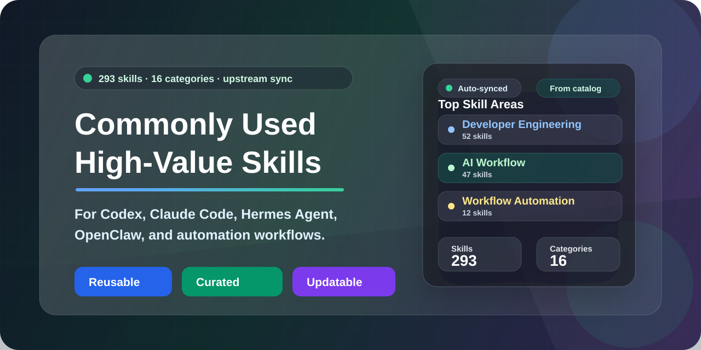

# Commonly Used High-Value Skills



[](./README.md)
[](./README.en.md)
[](./openclaw-skills/README.md)
[](./skills/)
[](./LICENSE)

面向全球 AI 开发者与 Agent 工作流构建者的高价值 Skills 仓库：按真实工作场景整理可直接复用的技能（`SKILL.md` + 脚本 + 参考资料），覆盖开发工程、DevOps、产品设计、运营、办公自动化、金融投资、AI 平台与安全治理。同一份源码适配 `Codex`、`Claude Code`、`Cursor`、`Hermes Agent` 和 `OpenClaw`，每个技能都有来源追踪、许可证审计和自动化质量校验。当前共 **16 个分类 / 293 个技能**。

[快速开始](#quick-start) · [分类导航](#categories) · [技能总览](#skill-overview) · [版本动态](#releases) · [参与共建](#contributing)

<a id="releases"></a>
## 版本动态

**v6.0.0 技能组合精简（2026-11-04）**：退役三个重复入口（`skill-vetter` → `skill-security-auditor`，`github` → `github-ops`，`neon-postgres-egress-optimizer` → `neon-postgres`），按真实工具重写 `find-skills`、`link-checker`（新增只读检查脚本）和 `figma`，并移除默认写入 `MEMORY.md`／定时任务的指令；同时为 46 个技能补齐带触发条件的描述，完成全量上游同步检查并升级 Hermes Agent 至 v0.22.7。当前 293 个技能 / 16 个分类。[发布说明](docs/releases/v6.0.0.md)。

从旧版本升级时，可用 `--prune-retired` 清理已退役的技能：只删除由本安装器安装且未改动过的副本，其余一律归档保留。

近期版本：

- [v5.0.0](docs/releases/v5.0.0.md)（2026-10-27）：完成全量策展，新增 `shadcn`、`security-model`、`remotion-video`；`self-improving-agent` 迁移为 `reflect-learn`。
- [v4.3.0](docs/releases/v4.3.0.md)（2026-10-24）：更新 4 个精选技能，升级行为改动与文字微调的验证流程。
- [v4.1.0](docs/releases/v4.1.0.md)（2026-10-16）：更新工程方法、飞书任务与图表、AKS 就绪检查和 Neon 检索指南，修复 macOS 离线 HTML 报告更新。
- [v4.0.0](docs/releases/v4.0.0.md)（2026-10-12）：修复 CodeQL 发现，新增“零开放 Code Scanning 告警”发布门禁，用更安全的离线 HTML 渲染器替换旧可执行文件。
- [v3.3.0](docs/releases/v3.3.0.md)（2026-10-12）：新增 Go 性能分析、基准测试与可观测性，架构深化、HTML 报告、动画拓扑面板和 Azure 诊断。
- [v3.2.0](docs/releases/v3.2.0.md)（2026-10-04）：新增 `grill-me` 计划压力测试，完成全量来源维护。

完整历史见 [CHANGELOG.md](./CHANGELOG.md) 与 [GitHub Releases](https://github.com/seaworld008/Commonly-used-high-value-skills/releases)。

## 为什么值得收藏

- **按场景收齐高频技能**：省去到处找 prompt、脚本和工作流的时间，既适合日常检索，也适合团队二次扩展。
- **不只是文档**：许多技能自带 `scripts/`、`references/`、`assets/`，可以直接复用。
- **一份源码，多端可用**：兼容 `Codex`、`Claude Code`、`Cursor`、`Antigravity`、`Hermes Agent`、`OpenClaw`，并提供 `npx` 一键安装器。
- **持续维护而非一次性收集**：自动发现新技能、同步上游更新、候选优选、质量门禁和生成视图形成闭环；来源策略文件统一管理白名单、黑名单、优先来源和准入门槛。
- **可信、可追溯**：每个技能都有 provenance 来源记录；外源技能必须通过许可证审计；发布前要求 CI 与 Code Scanning 全部通过；`dead-links` 工作流每月巡检外链。
- **自带安全审查能力**：`skill-security-auditor`、`security-review`、`input-guard`、`link-checker` 等技能可在安装外部技能前识别风险。
- **Hermes Agent 一等支持**：内置 `hermes-agent`、`native-mcp` 与 `hermes-open-gsd-workflow` 薄路由。

## 适合谁

- AI 开发者、Agent 工作流构建者和自动化工具使用者
- 想把常见任务沉淀为 Skills 的个人或团队
- 正在使用 `Codex`、`Claude Code`、`Cursor`、`Hermes Agent`、`OpenClaw` 等工具的工程师
- 想搭建自己的高价值技能库、提示库或 Agent 工作流库的人

<a id="quick-start"></a>
## 快速开始

### 我应该用哪个目录

| 客户端 / 场景 | 使用目录 | 说明 |
|---------------|----------|------|
| 让 `Codex` / `Claude Code` / `Hermes Agent` / `Cursor` 直接浏览仓库源码 | `skills/` | 保留分类结构，便于检索、维护与编辑 |
| `Codex` 本机安装 | `~/.codex/skills` | 用 npx 安装器或同步脚本平铺安装，便于客户端发现 |
| `Claude Code` 本机安装 | `~/.claude/skills` 或项目内 `.claude/skills` | 同上 |
| `OpenClaw` | `openclaw-skills/` | OpenClaw 只识别一层扁平目录，不要指向仓库根目录或 `skills/` |

### 方式一：npx 一键安装（推荐给命令行用户）

不想手动 clone 和复制目录时，可以直接用 GitHub 源运行安装器：

```bash
npx github:seaworld008/Commonly-used-high-value-skills install
```

默认安装到当前项目的 `.agents/skills`，适合支持 Agent Skills 约定的多种工具读取。也可以一次安装到多个客户端目录：

```bash
# 先预览：列出将写入的目录和技能，不做任何改动
npx github:seaworld008/Commonly-used-high-value-skills install --target codex,claude --dry-run

# 安装到 Codex 和 Claude Code 的用户级 skills 目录
npx github:seaworld008/Commonly-used-high-value-skills install --target codex,claude

# 只安装指定分类，减少默认上下文和维护面
npx github:seaworld008/Commonly-used-high-value-skills install --target codex --category developer-engineering,security-and-reliability

# 只安装明确需要的技能；可与 --category 组合取交集
npx github:seaworld008/Commonly-used-high-value-skills install --target codex --skill docx,xlsx,pdf,pptx

# 安装到自定义目录，适配其他 AI Agent 客户端
npx github:seaworld008/Commonly-used-high-value-skills install --target custom --dir ./vendor/agent-skills

# 固定到某个发布版本，便于团队复现
npx github:seaworld008/Commonly-used-high-value-skills#v6.0.0 install --target codex

# 浏览可选技能、分类和安装目标
npx github:seaworld008/Commonly-used-high-value-skills list-skills
npx github:seaworld008/Commonly-used-high-value-skills list-targets
```

可用目标：

| 目标 | 安装目录 |
|------|----------|
| `agents-project` | `./.agents/skills`（默认） |
| `codex` | `~/.codex/skills` |
| `claude` | `~/.claude/skills` |
| `claude-project` | `./.claude/skills` |
| `cursor` | `~/.cursor/skills` |
| `antigravity` | `~/.gemini/antigravity/skills` |
| `openclaw` | `~/.openclaw/skills`，本地仓库优先使用 `openclaw-skills/`，npx 包会从 `skills/` 平铺安装 |
| `custom` | 通过 `--dir` 指定 |

安装器的安全约定：

- `--dry-run` 只计算并打印安装计划，不写入任何文件。
- `--all` 表示写入所有标准客户端目标，并不是推荐的默认选项；按需选择 `--target`、`--category`、`--skill` 即可。
- 每个目标目录都会写入 `.high-value-skills-manifest.json`，记录来源与文件摘要；替换前先暂存并校验，被修改过或非本安装器管理的副本会归档到目标旁的 `.high-value-skills-backups/`。
- 这不是跨所有目标的原子事务：遇到报错时先检查输出和备份目录，不要手动删除旧副本。

如果你已经在使用 `skills.sh` 生态，也可以尝试标准安装入口：

```bash
npx skills add seaworld008/Commonly-used-high-value-skills --all -a codex -a claude-code --copy
```

本仓库自带的 `high-value-skills` 安装器更适合需要明确选择 Codex / Claude / Cursor / OpenClaw / 自定义目录的场景。

### 方式二：直接发给 AI 工具的安装提示词

如果你希望让 AI 工具直接帮你安装，优先发这段短提示词：

```text
你现在是我的本地安装助手，请把这个仓库 https://github.com/seaworld008/Commonly-used-high-value-skills 里的 Skills 安装到当前 AI 工具中。
```

如果 AI 工具没有自动识别出来，再补一句即可：

```text
当前工具是 `<Codex / Claude Code / Hermes Agent / Cursor / OpenClaw>`，本地仓库路径是 `<你的本地仓库路径>`。
```

之所以可以这样简化，是因为仓库里已经包含给 AI 工具读取的安装规则与目录约定（[AGENTS.md](./AGENTS.md)），通常不需要你把安装逻辑全部写进提示词。

### 方式三：手动安装步骤

1. 克隆本仓库到本地并进入目录：

```bash
git clone https://github.com/seaworld008/Commonly-used-high-value-skills.git
cd Commonly-used-high-value-skills
```

2. 如果你使用 `Codex`，同步到本机 Codex skills 目录：

```bash
python3 scripts/sync_codex_skills.py --source-root ./skills --codex-root ~/.codex/skills
```

Windows PowerShell 示例：

```powershell
python scripts/sync_codex_skills.py --source-root ".\skills" --codex-root "$env:USERPROFILE\.codex\skills"
```

3. 如果你使用 `Claude Code`，同步到个人或项目级 skills 目录：

```bash
# 个人级，所有项目可用
python3 scripts/sync_codex_skills.py --source-root ./skills --codex-root ~/.claude/skills

# 项目级，只在当前项目可用
python3 scripts/sync_codex_skills.py --source-root ./skills --codex-root ./.claude/skills
```

Windows PowerShell 示例：

```powershell
python scripts/sync_codex_skills.py --source-root ".\skills" --codex-root "$env:USERPROFILE\.claude\skills"
```

这里的 `--codex-root` 是同步脚本沿用的参数名，实际含义是“目标技能目录”，也可以指向 `Claude Code` 等其他客户端的 skills 目录。

4. 如果你使用 `Hermes Agent`、`Cursor` 或其他能浏览源码目录的 AI coding assistant，优先把工具指向仓库内的 `skills/`；如果目标工具要求一层扁平技能目录，可以复用上面的同步命令，把 `--codex-root` 改成该工具自己的 skills 目录。

5. 如果你使用 `OpenClaw`，先生成扁平导出目录：

```bash
python3 scripts/export_openclaw_skills.py
```

然后在 OpenClaw 配置里把 `openclaw-skills/` 加到 `skills.load.extraDirs`（不要指向仓库根目录或 `skills/`），并确认已识别：

```bash
openclaw skills list
openclaw skills check
```

6. 任选几个技能目录检查是否能正常读取，例如：
   - `skills/developer-engineering/codebase-onboarding`
   - `skills/security-and-reliability/skill-security-auditor`
   - `openclaw-skills/codebase-onboarding`

更多按客户端的安装示例：

- [按客户端安装示例](./docs/client-install-guides.md)
- [nlpm-audit 使用指南](./docs/nlpm-audit-usage.md)：安装到 `Codex` / `Claude Code` / `OpenClaw` 后如何自动触发、显式调用、生成 Markdown 审计报告和配置持续升级。

<a id="categories"></a>
## 分类快速跳转

| 分类 | 说明 | 文档跳转 | 目录 |
|------|------|----------|------|
| 开发工程 | 开发、测试、性能、代码审查、数据库与架构 | [跳转](#cat-developer-engineering) | [目录](./skills/developer-engineering/) |
| AI 工作流 | Agent 技能使用、规划、实现、评审、验证与发布闭环 | [跳转](#cat-ai-workflow) | [目录](./skills/ai-workflow/) |
| AI 平台与 Agent 开发 | ChatGPT Apps、Hermes、MCP、Figma、OpenAI Docs 与自主 Agent | [跳转](#cat-ai-agent-platform) | [目录](./skills/ai-agent-platform/) |
| 工程工作流自动化 | 浏览器自动化、GitHub、Notebook、Playwright、graphify/GSD | [跳转](#cat-workflow-automation) | [目录](./skills/engineering-workflow-automation/) |
| DevOps / SRE | 发布、监控、故障响应、CI/CD、环境管理 | [跳转](#cat-devops-sre) | [目录](./skills/devops-sre/) |
| 金融投资 | 金融数据、估值、风控、回测、投研写作 | [跳转](#cat-finance-investing) | [目录](./skills/finance-investing/) |
| 增长运营 | 小红书、社媒、内容、归因、竞品分析 | [跳转](#cat-growth-operations) | [目录](./skills/growth-operations-xiaohongshu/) |
| 办公与文档 | Word、Excel、PPT、PDF、会议纪要 | [跳转](#cat-office-white-collar) | [目录](./skills/office-white-collar/) |
| 项目管理与知识库集成 | Notion、Linear、Obsidian、飞书/Lark、规格到实施 | [跳转](#cat-knowledge-pm) | [目录](./skills/knowledge-and-pm-integrations/) |
| 通用运营 | 品牌、事实核查、内部沟通、主题与天气 | [跳转](#cat-operations-general) | [目录](./skills/operations-general/) |
| 产品与设计 | 产品分析、设计系统、UX 研究、SaaS 脚手架 | [跳转](#cat-product-design) | [目录](./skills/product-design/) |
| 安全治理与稳定性 | Sentry、安全最佳实践、威胁建模、漏洞扫描 | [跳转](#cat-security-reliability) | [目录](./skills/security-and-reliability/) |
| 多模态内容 | 图像、语音、视频、截图、摘要、转写 | [跳转](#cat-multimodal-media) | [目录](./skills/multimodal-media/) |
| 部署平台 | Cloudflare、Netlify、Render、Vercel | [跳转](#cat-deployment-platforms) | [目录](./skills/deployment-platforms/) |
| 记忆与安全 | 长期记忆、输入防护、RAG、Runbook | [跳转](#cat-memory-safety) | [目录](./skills/openclaw-memory-and-safety/) |
| 任务理解与拆解 | 联网检索、复盘学习与任务理解补充能力 | [跳转](#cat-task-understanding) | [目录](./skills/task-understanding-decomposition/) |

## 从哪里开始最容易上手

第一次使用，推荐先浏览“开发工程”“AI 工作流”“AI 平台与 Agent 开发”和“安全治理与稳定性”四个分类，或者直接试用这些代表性技能：

- `codebase-onboarding`：快速理解代码库结构、技术栈、关键模块和上手路径。
- `context-engineering`：诊断缺失或过载的上下文，配置项目级 Agent 指令。
- `agent-workflow-designer`：设计多步骤 Agent 工作流、角色分工和执行闭环。
- `gh-fix-ci`：定位 GitHub Actions 失败原因并修复 CI 流水线。
- `financial-data-collector`：收集股票、财报、市场和宏观金融数据。
- `notion-spec-to-implementation`：把 Notion 规格文档转化为可执行的实现任务。
- `transcribe`：把音频或视频转写为文本，并整理说话人和时间信息。
- `skill-security-auditor`：安装或更新外部技能前，静态扫描并人工审查权限、依赖和来源风险。
- `github-ops`：通过 `gh` 处理 PR、Issue、Review、发布和 Actions 协作。

## Hermes Agent 支持

`Hermes Agent` 是本仓库正式支持的消费端之一，而不只是“包含几个 Hermes 相关技能”：

- 源码浏览时统一使用 `skills/`；本机安装到 `Codex` / `Claude Code` 时同步到各自 skills 目录。
- [`hermes-agent`](./skills/ai-agent-platform/hermes-agent/)：随上游官方版本同步，覆盖 CLI、gateway、profiles、memory、skills、MCP 与贡献开发说明。
- [`native-mcp`](./skills/ai-agent-platform/native-mcp/)：帮助 Hermes 连接外部 MCP server。
- [`hermes-open-gsd-workflow`](./skills/ai-agent-platform/hermes-open-gsd-workflow/)：薄路由，按请求选择 Hermes、Graphify、Open GSD Core 或显式可选的 GSD Pi。

Hermes 用户推荐从 [`skills/ai-agent-platform/README.md`](./skills/ai-agent-platform/README.md) 和[按客户端安装示例](./docs/client-install-guides.md)开始。

### Hermes、Graphify 与 Open GSD

仓库收录官方 Hermes artifact set 和保留完整官方参考资料的 Graphify 策展入口，并把 Open GSD Core / Pi 作为受管 bundle；本地组合层只保留 `hermes-open-gsd-workflow` 这一个入口，不复制版本、安装命令或状态机。实际版本、完整性摘要、安装器和 inventory 以 [`docs/sources/`](./docs/sources/) 的 canonical provenance / bundle metadata 为准。旧的 Hermes + Graphify + GSD 组合技能及其迁移兼容层已删除，portfolio denylist 只负责阻止这些旧名称被重新引入。

## GPT-6 Astra 指令优化

技能采用简洁触发、按需资料和按风险验证的执行方式。全量审计说明、官方来源及模型评测边界见 [Astra 适配指南](docs/astra-skill-guidance.md)，日常维护使用[统一工作流](docs/maintenance-workflow.md)。仓库内容更新与本地模型配置、技能安装分别管理。Codex / Claude 的共享格式、宿主差异和验证边界见[双端兼容说明](docs/cross-agent-compatibility.md)。

## 目录结构

```text
skills/
  developer-engineering/                # 开发工程
  ai-workflow/                          # AI 工作流（Agent Skills / 上下文工程 / 计划执行）
  ai-agent-platform/                    # AI 平台与 Agent 开发
  engineering-workflow-automation/      # 工程工作流自动化（GitHub/CI/测试）
  devops-sre/                           # DevOps / SRE
  finance-investing/                    # 金融投资与投研分析
  growth-operations-xiaohongshu/        # 增长运营（小红书/社媒）
  office-white-collar/                  # 办公与文档生产力
  knowledge-and-pm-integrations/        # 项目管理与知识库集成（Linear/Notion/Obsidian/飞书）
  operations-general/                   # 通用运营
  product-design/                       # 产品与设计
  security-and-reliability/             # 安全治理与稳定性
  multimodal-media/                     # 多模态内容（图像/语音/视频/转写）
  deployment-platforms/                 # 部署平台（Vercel/Netlify/Render/Cloudflare）
  openclaw-memory-and-safety/           # 记忆与安全
  task-understanding-decomposition/     # 任务理解与拆解
openclaw-skills/                        # 为 OpenClaw 生成的扁平兼容导出目录（不要手工编辑）
docs/                                   # 维护文档、发布说明、来源记录与生成的目录
scripts/                                # 安装、同步、生成与校验脚本
```

## 使用方式

1. 按分类进入目标目录（如 `skills/developer-engineering/`），或在下方技能总览中点击技能名。
2. 打开对应技能的 `SKILL.md`，查看触发条件、操作流程、边界和脚本说明。
3. 如果技能下含 `scripts/`、`references/`、`assets/`，优先复用现成内容。

快速检索：

```bash
# 列出所有技能定义文件
rg --files skills -g SKILL.md

# 按关键词查找技能
rg -n -g SKILL.md "prompt|security|pdf|deploy" skills
```

<a id="skill-overview"></a>
## 技能总览（按分类，16 类 / 293 技能）

<a id="cat-developer-engineering"></a>
### 1. 开发工程（developer-engineering，52）

- [`agent-designer`](./skills/developer-engineering/agent-designer/)：设计智能体的职责、工具、记忆、协作架构和评测方法。
- [`api-design-reviewer`](./skills/developer-engineering/api-design-reviewer/)：用于评审 API 设计的一致性、可用性、版本策略、错误语义、安全性和开发者体验。
- [`api-test-suite-builder`](./skills/developer-engineering/api-test-suite-builder/)：根据接口契约生成认证、输入校验、错误和边界测试。
- [`aws-solution-architect`](./skills/developer-engineering/aws-solution-architect/)：用于 AWS 云架构设计、服务选型、成本优化与 Well-Architected Framework 评估。
- [`builder`](./skills/developer-engineering/builder/)：实现生产级业务逻辑时使用：类型安全领域模型、边界校验、健壮的接口集成与 CQRS/事件溯源。
- [`cli-demo-generator`](./skills/developer-engineering/cli-demo-generator/)：把命令行操作制作成终端录屏和动态演示 GIF。
- [`codebase-inspection`](./skills/developer-engineering/codebase-inspection/)：用于用 pygount 检查代码行数、语言构成、仓库规模和代码/注释比例。
- [`codebase-onboarding`](./skills/developer-engineering/codebase-onboarding/)：生成代码库架构、环境搭建和常见开发任务的入门指南。
- [`database-designer`](./skills/developer-engineering/database-designer/)：设计和优化数据库结构、查询及迁移方案。
- [`database-schema-designer`](./skills/developer-engineering/database-schema-designer/)：设计数据表、约束、索引、迁移和行级权限策略。
- [`dependency-auditor`](./skills/developer-engineering/dependency-auditor/)：梳理依赖清单，核实漏洞与许可证证据，规划可验证的升级。
- [`docker-expert`](./skills/developer-engineering/docker-expert/)：用于 Docker 容器化最佳实践、多阶段构建优化与 Docker Compose 编排。
- [`frontend-design`](./skills/developer-engineering/frontend-design/)：用于创建高质量、非模板化的前端页面、组件、仪表盘、海报和 Web UI。
- [`gateway`](./skills/developer-engineering/gateway/)：设计或评审 REST/GraphQL 接口时使用：OpenAPI 规范、版本与弃用策略、破坏性变更检测和接口安全。
- [`git-worktree-manager`](./skills/developer-engineering/git-worktree-manager/)：管理并行开发的 Git worktree、环境和端口分配。
- [`github-contributor`](./skills/developer-engineering/github-contributor/)：寻找开源贡献机会并准备可审查的 GitHub PR。
- [`golang-benchmark`](./skills/developer-engineering/golang-benchmark/)：使用 Go benchmark、pprof、benchstat 及 CI 回归分析性能。
- [`golang-performance`](./skills/developer-engineering/golang-performance/)：用性能基线和 pprof 分析优化 Go 热点、内存分配、GC、缓存及网络 I/O。
- [`graphify`](./skills/developer-engineering/graphify/)：将代码、文档和多媒体资料映射为持久知识图谱，支持社区发现、路径查询、解释和影响分析。
- [`graphql-expert`](./skills/developer-engineering/graphql-expert/)：用于 GraphQL API 设计、Schema/Resolver 评审、查询优化和安全最佳实践。
- [`i18n-expert`](./skills/developer-engineering/i18n-expert/)：实现和审查界面国际化、翻译键、语言文件与格式一致性。
- [`improve-codebase-architecture`](./skills/developer-engineering/improve-codebase-architecture/)：结合变更热点、接口深度与测试证据识别高价值架构重构。
- [`kubernetes-specialist`](./skills/developer-engineering/kubernetes-specialist/)：用于 Kubernetes 集群管理、Pod 调试、Helm Chart 设计、清单评审和部署优化。
- [`mcp-builder`](./skills/developer-engineering/mcp-builder/)：开发连接外部服务的 MCP 工具服务器。
- [`migration-architect`](./skills/developer-engineering/migration-architect/)：规划可回滚、低停机的数据和系统迁移。
- [`monorepo-navigator`](./skills/developer-engineering/monorepo-navigator/)：分析多包仓库的依赖、构建、缓存和变更影响。
- [`neon-postgres`](./skills/developer-engineering/neon-postgres/)：用于 Neon Postgres 数据库连接、分支、迁移和运行维护。
- [`nextjs-app-router`](./skills/developer-engineering/nextjs-app-router/)：用于 Next.js App Router 项目开发、路由设计和服务端渲染实践。
- [`performance-profiler`](./skills/developer-engineering/performance-profiler/)：分析 CPU、内存、I/O 和查询瓶颈并验证优化效果。
- [`pr-review-expert`](./skills/developer-engineering/pr-review-expert/)：审查 PR 的正确性、安全、兼容性和测试覆盖变化。
- [`prisma-client-api`](./skills/developer-engineering/prisma-client-api/)：用于 Prisma Client 查询、关联写入、事务、分页与原生 SQL 审查。
- [`prisma-upgrade-v7`](./skills/developer-engineering/prisma-upgrade-v7/)：用于 Prisma ORM 6 到 7 的 SQL 项目迁移、驱动适配器、客户端导入与配置升级。
- [`promptfoo-evaluation`](./skills/developer-engineering/promptfoo-evaluation/)：配置和运行 Promptfoo 提示词、模型及输出质量评测。
- [`python-performance`](./skills/developer-engineering/python-performance/)：用于 Python 性能分析、内存优化、热点路径调优和并发模式评审。
- [`qa-expert`](./skills/developer-engineering/qa-expert/)：制定测试策略、风险用例、执行计划和缺陷跟踪流程。
- [`react-native-engineering`](./skills/developer-engineering/react-native-engineering/)：用于构建、审查、调试、测试、升级和发布 React Native 与 Expo 应用，覆盖新架构、原生模块、性能、EAS 和双平台验证。
- [`repomix-safe-mixer`](./skills/developer-engineering/repomix-safe-mixer/)：打包代码前扫描凭据、输出脱敏报告，并在发现风险时阻止打包。
- [`rust-engineer`](./skills/developer-engineering/rust-engineer/)：用于 Rust 代码开发、所有权和生命周期调试、异步模式选择和系统性能优化。
- [`schema`](./skills/developer-engineering/schema/)：设计或评审数据库模式时使用：数据建模、零停机迁移、索引策略、多租户隔离和向量表。
- [`shadcn`](./skills/developer-engineering/shadcn/)：维护 shadcn 组件、注册源和主题，核对项目真实 API，并验证预览差异与交互结果。
- [`skill-tester`](./skills/developer-engineering/skill-tester/)：验证技能触发、执行步骤和输出结果是否符合预期。
- [`supabase`](./skills/developer-engineering/supabase/)：开发和排查 Supabase 数据库、认证、存储及应用集成。
- [`supabase-postgres-best-practices`](./skills/developer-engineering/supabase-postgres-best-practices/)：用于编写或评审 Supabase/Postgres 的查询、Schema、索引、RLS、连接配置与迁移。
- [`systematic-debugging`](./skills/developer-engineering/systematic-debugging/)：通过复现、假设检验和证据定位故障根因。
- [`tailwind-design-system`](./skills/developer-engineering/tailwind-design-system/)：用于 Tailwind CSS 设计系统、主题 token、组件样式和响应式布局规范。
- [`tech-debt-tracker`](./skills/developer-engineering/tech-debt-tracker/)：识别和量化技术债，确定修复优先级并跟踪治理进度。
- [`terraform-engineer`](./skills/developer-engineering/terraform-engineer/)：用于 Terraform IaC 设计、模块评审、状态管理、Provider 升级和基础设施部署优化。
- [`typescript-best-practices`](./skills/developer-engineering/typescript-best-practices/)：用于 TypeScript 类型安全设计、高级类型、API 边界、strict 迁移和反模式规避。
- [`vercel-react-best-practices`](./skills/developer-engineering/vercel-react-best-practices/)：用于 Vercel/React 项目的架构、性能和部署最佳实践。
- [`vercel-react-view-transitions`](./skills/developer-engineering/vercel-react-view-transitions/)：用于在 React/Vercel 项目中实现和优化 View Transitions。
- [`web-artifacts-builder`](./skills/developer-engineering/web-artifacts-builder/)：用于构建复杂多组件 HTML/React 网页 artifacts，尤其适合需要状态、路由或 shadcn/ui 的场景。
- [`webapp-testing`](./skills/developer-engineering/webapp-testing/)：用于使用 Playwright 测试本地 Web 应用、验证前端行为、截图和查看浏览器日志。

<a id="cat-ai-workflow"></a>
### 2. AI 工作流（ai-workflow，47）

- [`agent-workflow-designer`](./skills/ai-workflow/agent-workflow-designer/)：设计多智能体协作流程、任务交接、状态管理和故障恢复。
- [`andrej-karpathy-skills`](./skills/ai-workflow/andrej-karpathy-skills/)：用于应用 Andrej Karpathy 风格的 AI 学习、构建和研究实践。
- [`api-and-interface-design`](./skills/ai-workflow/api-and-interface-design/)：设计稳定的 API、模块接口和类型契约。
- [`brainstorming`](./skills/ai-workflow/brainstorming/)：用于在实现前澄清创意型产品或工程需求，探索目标、约束、方案与取舍。
- [`browser-testing-with-devtools`](./skills/ai-workflow/browser-testing-with-devtools/)：用于通过浏览器 DevTools 测试、调试和验证前端行为。
- [`ci-cd-and-automation`](./skills/ai-workflow/ci-cd-and-automation/)：建立和优化持续集成、质量检查与部署自动化。
- [`code-review-and-quality`](./skills/ai-workflow/code-review-and-quality/)：审查代码正确性、可维护性、安全性和验证证据。
- [`code-simplification`](./skills/ai-workflow/code-simplification/)：在保持行为一致的前提下简化代码和消除重复。
- [`context-engineering`](./skills/ai-workflow/context-engineering/)：用于设计上下文工程策略、提示输入结构和长任务信息流。
- [`debugging-and-error-recovery`](./skills/ai-workflow/debugging-and-error-recovery/)：复现故障、定位根因并验证修复与恢复结果。
- [`deep-research`](./skills/ai-workflow/deep-research/)：用于执行深度研究、资料收集、来源核验和综合分析。
- [`deprecation-and-migration`](./skills/ai-workflow/deprecation-and-migration/)：规划旧系统、接口和功能的弃用及迁移。
- [`dispatching-parallel-agents`](./skills/ai-workflow/dispatching-parallel-agents/)：用于拆分任务并调度多个 Agent 并行协作。
- [`documentation-and-adrs`](./skills/ai-workflow/documentation-and-adrs/)：记录架构决策、接口变化和工程交接信息。
- [`doubt-driven-development`](./skills/ai-workflow/doubt-driven-development/)：用新上下文的对抗性审查质疑关键决策，适用于高风险或正确性优先的开发任务。
- [`executing-plans`](./skills/ai-workflow/executing-plans/)：用于按既定实现计划逐步执行任务，并在关键节点进行审查和完成验证。
- [`find-skills`](./skills/ai-workflow/find-skills/)：在已安装技能和公开技能目录中检索、比较候选，帮助判断用哪个技能或是否安装。
- [`finishing-a-development-branch`](./skills/ai-workflow/finishing-a-development-branch/)：完成开发分支的验证、PR、合并和工作区收尾。
- [`frontend-ui-engineering`](./skills/ai-workflow/frontend-ui-engineering/)：实现可访问、响应式的前端界面和交互状态。
- [`git-workflow-and-versioning`](./skills/ai-workflow/git-workflow-and-versioning/)：管理 Git 分支、提交、冲突、版本和变更记录。
- [`idea-refine`](./skills/ai-workflow/idea-refine/)：澄清初步想法，比较方案并检验关键假设。
- [`incremental-implementation`](./skills/ai-workflow/incremental-implementation/)：将功能拆成可验证的小步改动并逐步完成实现。
- [`interview-me`](./skills/ai-workflow/interview-me/)：通过逐问访谈澄清真实需求、目标用户与成功标准，避免在含糊请求上过早实施。
- [`nexus`](./skills/ai-workflow/nexus/)：任务需要多个专家智能体协作时使用：分类任务、选择最小链路、编排执行并验证汇总结果。
- [`nlpm-audit`](./skills/ai-workflow/nlpm-audit/)：审计 SKILL.md、AGENTS.md、CLAUDE.md、插件清单、hooks、commands 和提示词，检查安装一致性、质量评分、安全风险与版本漂移。
- [`observability-and-instrumentation`](./skills/ai-workflow/observability-and-instrumentation/)：为生产代码设计日志、指标、追踪和告警，使行为可观测、问题可诊断。
- [`performance-optimization`](./skills/ai-workflow/performance-optimization/)：基于测量优化前后端与数据库性能，并用 CI 预算和真实用户监测防止回退。
- [`planning-and-task-breakdown`](./skills/ai-workflow/planning-and-task-breakdown/)：将需求拆成有依赖与验收标准的任务，并保护已有未完成计划。
- [`prompt-optimizer`](./skills/ai-workflow/prompt-optimizer/)：优化提示词的任务范围、约束和验收条件。
- [`rally`](./skills/ai-workflow/rally/)：需要把独立任务并行分发到多个智能体会话或引擎时使用，含工作树隔离、冲突处理与汇总校验。
- [`receiving-code-review`](./skills/ai-workflow/receiving-code-review/)：核实代码审查意见并处理有证据支持的问题。
- [`requesting-code-review`](./skills/ai-workflow/requesting-code-review/)：用于在完成任务、实现重要功能或合并前请求代码审查并验证需求满足情况。
- [`security-and-hardening`](./skills/ai-workflow/security-and-hardening/)：加固身份认证、输入处理、数据存储和外部集成。
- [`sherpa`](./skills/ai-workflow/sherpa/)：复杂任务需要拆成短小原子步骤、跟踪进度并防止范围漂移时使用。
- [`shipping-and-launch`](./skills/ai-workflow/shipping-and-launch/)：准备生产发布、分批上线、监控和回滚方案。
- [`skill-creator`](./skills/ai-workflow/skill-creator/)：创建和改进技能内容、触发描述及行为评测。
- [`skill-reviewer`](./skills/ai-workflow/skill-reviewer/)：审查技能的触发边界、执行指导、引用和验证质量。
- [`source-driven-development`](./skills/ai-workflow/source-driven-development/)：依据官方文档和当前仓库证据实现功能。
- [`spec-driven-development`](./skills/ai-workflow/spec-driven-development/)：把需求转成明确的功能边界、契约和验收标准。
- [`subagent-driven-development`](./skills/ai-workflow/subagent-driven-development/)：协调独立子任务的实现、审查和结果集成。
- [`test-driven-development`](./skills/ai-workflow/test-driven-development/)：通过聚焦的回归测试验证业务逻辑和缺陷修复。
- [`using-agent-skills`](./skills/ai-workflow/using-agent-skills/)：用于选择、加载和正确使用 Agent Skills 完成任务。
- [`using-git-worktrees`](./skills/ai-workflow/using-git-worktrees/)：用于使用 Git worktree 隔离并行开发和审查工作。
- [`using-superpowers`](./skills/ai-workflow/using-superpowers/)：用于使用 Superpowers 工作流提升计划、执行和验证质量。
- [`verification-before-completion`](./skills/ai-workflow/verification-before-completion/)：在宣告完成前核对当前代码的验证证据与适用范围。
- [`writing-plans`](./skills/ai-workflow/writing-plans/)：编写包含任务依赖、修改范围和验收方法的实现计划。
- [`writing-skills`](./skills/ai-workflow/writing-skills/)：编写可复用的技能指导并验证实际触发和执行行为。

<a id="cat-ai-agent-platform"></a>
### 3. AI 平台与 Agent 开发（ai-agent-platform，13）

- [`agent-hub`](./skills/ai-agent-platform/agent-hub/)：用于管理 Agent 能力中心、技能发现、路由和协作工作流。
- [`arena`](./skills/ai-agent-platform/arena/)：用于构建和运行 Agent 竞技场、评测对战和能力比较流程。
- [`chatgpt-apps`](./skills/ai-agent-platform/chatgpt-apps/)：用于设计、构建和调试 ChatGPT Apps 与相关集成能力。
- [`develop-web-game`](./skills/ai-agent-platform/develop-web-game/)：用于开发网页游戏原型、玩法循环、交互逻辑和前端实现。
- [`figma`](./skills/ai-agent-platform/figma/)：通过 Figma MCP 读取设计上下文、变量、截图和素材，并排查连接问题。
- [`figma-implement-design`](./skills/ai-agent-platform/figma-implement-design/)：用于将 Figma 设计转化为可实现的前端界面和组件。
- [`hermes-agent`](./skills/ai-agent-platform/hermes-agent/)：用于配置、扩展、调试和贡献 Hermes Agent，包括多 Agent、CLI 和网关工作流。
- [`hermes-open-gsd-workflow`](./skills/ai-agent-platform/hermes-open-gsd-workflow/)：在 Hermes Agent、Graphify、Open GSD Core 与可选 GSD Pi 之间做薄路由，不复制上游安装器和状态机。
- [`mcporter`](./skills/ai-agent-platform/mcporter/)：用于通过 mcporter CLI 列出、配置、鉴权和调用 MCP 服务器或工具。
- [`native-mcp`](./skills/ai-agent-platform/native-mcp/)：用于构建和调试原生 MCP 集成、服务器和工具调用流程。
- [`openai-docs`](./skills/ai-agent-platform/openai-docs/)：用于查阅和应用 OpenAI 官方文档、API 行为和集成指南。
- [`oracle`](./skills/ai-agent-platform/oracle/)：设计或评审大模型应用时使用：提示词、RAG、智能体工具循环、评测、安全护栏和成本路由。
- [`sigil`](./skills/ai-agent-platform/sigil/)：需要根据仓库技术栈与约定生成、校验或更新项目专属技能时使用。

<a id="cat-workflow-automation"></a>
### 4. 工程工作流自动化（engineering-workflow-automation，12）

- [`agent-browser`](./skills/engineering-workflow-automation/agent-browser/)：在授权浏览器会话中利用官方 agent-browser CLI 快照和 CDP 完成自动化验收。
- [`billing-automation`](./skills/engineering-workflow-automation/billing-automation/)：用于构建订阅计费、自动开票、续费生命周期和催收管理流程。
- [`gh-address-comments`](./skills/engineering-workflow-automation/gh-address-comments/)：用于通过 gh CLI 处理当前分支的 GitHub PR Review 评论或 Issue 评论。
- [`gh-fix-ci`](./skills/engineering-workflow-automation/gh-fix-ci/)：读取 GitHub Actions 失败日志，修复 CI 并验证 PR 检查。
- [`guardian`](./skills/engineering-workflow-automation/guardian/)：整理提交或评审合并请求时使用：变更分类、PR 质量与风险评分、分支策略和合并把关。
- [`harvest`](./skills/engineering-workflow-automation/harvest/)：采集合并请求信息并生成工作报告和发布材料。
- [`jupyter-notebook`](./skills/engineering-workflow-automation/jupyter-notebook/)：创建和维护用于分析、实验及教学的 Jupyter 笔记本。
- [`latch`](./skills/engineering-workflow-automation/latch/)：配置和维护生命周期钩子、质量门禁和自动化守卫。
- [`playwright`](./skills/engineering-workflow-automation/playwright/)：用于使用 Playwright 编写、运行和调试端到端测试。
- [`playwright-pro`](./skills/engineering-workflow-automation/playwright-pro/)：用于高级 Playwright 测试、诊断、稳定性和浏览器自动化。
- [`web-scraper`](./skills/engineering-workflow-automation/web-scraper/)：用于网页抓取、结构化数据提取、爬取策略、选择器设计和增量更新。
- [`yeet`](./skills/engineering-workflow-automation/yeet/)：按用户要求暂存、提交、推送改动并创建 GitHub PR。

<a id="cat-devops-sre"></a>
### 5. DevOps / SRE（devops-sre，14）

- [`azure-diagnostics`](./skills/devops-sre/azure-diagnostics/)：使用授权范围内的指标、日志和脚本定位 Azure AKS、虚拟机及应用故障。
- [`azure-kubernetes`](./skills/devops-sre/azure-kubernetes/)：用于 Azure Kubernetes 集群管理、部署、排障和运维。
- [`beacon`](./skills/devops-sre/beacon/)：为服务设计 SLO、错误预算、告警、链路追踪、仪表盘或容量规划时使用。
- [`cc-devops-skills`](./skills/devops-sre/cc-devops-skills/)：提供基础设施、持续交付、容器和运行维护的实践指导。
- [`cloudflare-troubleshooting`](./skills/devops-sre/cloudflare-troubleshooting/)：依据实际配置排查 Cloudflare DNS、TLS 和重定向问题。
- [`env-secrets-manager`](./skills/devops-sre/env-secrets-manager/)：管理环境变量、密钥存储、泄露检测和凭据轮换。
- [`gear`](./skills/devops-sre/gear/)：维护依赖、CI 工作流、容器构建、代码规范工具或排查构建失败时使用。
- [`github-ops`](./skills/devops-sre/github-ops/)：通过 gh CLI 和 API 处理 GitHub 仓库、PR、Issue、Review、标签、发布和 Actions 协作。
- [`golang-observability`](./skills/devops-sre/golang-observability/)：为 Go 服务设计 slog、OpenTelemetry、Prometheus、持续剖析及可靠性告警。
- [`incident-commander`](./skills/devops-sre/incident-commander/)：用于事故响应中的分诊、角色分配、沟通协调、缓解跟踪和复盘。
- [`observability-designer`](./skills/devops-sre/observability-designer/)：设计日志、指标、链路追踪、告警和服务运行目标。
- [`release-manager`](./skills/devops-sre/release-manager/)：组织版本、变更记录、发布制品和发布后验证。
- [`senior-architect`](./skills/devops-sre/senior-architect/)：分析系统架构、依赖、扩展性和关键技术取舍。
- [`triage`](./skills/devops-sre/triage/)：处理线上事故时使用：定级、评估影响、协调止损与沟通，并推进根因分析和复盘。

<a id="cat-finance-investing"></a>
### 6. 金融投资（finance-investing，16）

- [`comps-valuation-analyst`](./skills/finance-investing/comps-valuation-analyst/)：依据可比公司和统一财务口径开展相对估值分析。
- [`earnings-call-analyzer`](./skills/finance-investing/earnings-call-analyzer/)：用于摘要财报电话会、提取管理层语气变化、业绩指引措辞和投资者更新。
- [`event-driven-tracker`](./skills/finance-investing/event-driven-tracker/)：跟踪影响投资标的的公司事件、催化因素和风险。
- [`factor-backtester`](./skills/finance-investing/factor-backtester/)：设计和回测投资因子，检查偏差、成本和稳健性。
- [`financial-analyst`](./skills/finance-investing/financial-analyst/)：分析财务报表、经营表现、估值和情景假设。
- [`financial-data-collector`](./skills/finance-investing/financial-data-collector/)：用于收集股票、财报、宏观和市场数据并生成分析输入。
- [`helm`](./skills/finance-investing/helm/)：商业战略场景模拟、市场分析、指标预测和路线图规划。
- [`investment-memo-writer`](./skills/finance-investing/investment-memo-writer/)：编写有来源依据、投资逻辑和风险分析的投资备忘录。
- [`ledger`](./skills/finance-investing/ledger/)：估算或优化云成本时使用：IaC 成本预估、规格调整、预留实例、标签策略和预算告警。
- [`levy`](./skills/finance-investing/levy/)：依据目标税年和官方规则分析日本税务及申报问题。
- [`macro-regime-monitor`](./skills/finance-investing/macro-regime-monitor/)：监测宏观经济状态、市场指标和投资环境变化。
- [`options-strategy-evaluator`](./skills/finance-investing/options-strategy-evaluator/)：评估期权策略的收益结构、希腊字母和情景风险。
- [`portfolio-risk-manager`](./skills/finance-investing/portfolio-risk-manager/)：用于投资组合风险分析、仓位约束和风险报告生成。
- [`saas-metrics-coach`](./skills/finance-investing/saas-metrics-coach/)：分析 SaaS 收入、留存、获客成本和单位经济性。
- [`sec-filing-reviewer`](./skills/finance-investing/sec-filing-reviewer/)：阅读和比较 SEC 申报文件中的财务信息与风险变化。
- [`stock-screener-builder`](./skills/finance-investing/stock-screener-builder/)：建立有明确指标、数据来源和筛选规则的股票筛选器。

<a id="cat-growth-operations"></a>
### 7. 增长运营（growth-operations-xiaohongshu，15）

- [`algorithmic-art`](./skills/growth-operations-xiaohongshu/algorithmic-art/)：用代码、随机种子和交互参数创作原创生成艺术。
- [`app-store-optimization`](./skills/growth-operations-xiaohongshu/app-store-optimization/)：优化应用商店关键词、页面素材和转化实验。
- [`campaign-analytics`](./skills/growth-operations-xiaohongshu/campaign-analytics/)：分析营销活动的渠道表现、转化、归因和投入产出。
- [`compete`](./skills/growth-operations-xiaohongshu/compete/)：研究竞争对手时使用：竞品画像、功能与定价对比、定位图、竞争战卡和输赢分析。
- [`competitors-analysis`](./skills/growth-operations-xiaohongshu/competitors-analysis/)：Analyze competitor repositories with evidence-based approa。
- [`content-creator`](./skills/growth-operations-xiaohongshu/content-creator/)：按受众、品牌语气和搜索意图创作营销内容。
- [`growth`](./skills/growth-operations-xiaohongshu/growth/)：提升网页自然流量与转化时使用：SEO 元信息、结构化数据、社交卡片、核心性能指标和 AI 引用优化。
- [`linkedin-growth`](./skills/growth-operations-xiaohongshu/linkedin-growth/)：构建领英线索导入、筛选、分配、邀请与待处理请求维护流水线。
- [`marketing-demand-acquisition`](./skills/growth-operations-xiaohongshu/marketing-demand-acquisition/)：规划付费投放、自然渠道和获客转化流程。
- [`marketing-strategy-pmm`](./skills/growth-operations-xiaohongshu/marketing-strategy-pmm/)：制定产品定位、市场进入、竞争分析和销售支持策略。
- [`pulse`](./skills/growth-operations-xiaohongshu/pulse/)：定义产品指标与埋点时使用：北极星指标、事件规范、漏斗、留存分析和仪表盘规格。
- [`social-media-analyzer`](./skills/growth-operations-xiaohongshu/social-media-analyzer/)：分析社交媒体互动、受众、活动收益和跨平台表现。
- [`tweetclaw-source-research`](./skills/growth-operations-xiaohongshu/tweetclaw-source-research/)：通过 TweetClaw 收集和核实 X 平台研究资料。
- [`twitter-reader`](./skills/growth-operations-xiaohongshu/twitter-reader/)：用于通过 URL 抓取 Twitter/X 帖子内容、作者、时间、图片和线程回复。
- [`x-twitter-scraper`](./skills/growth-operations-xiaohongshu/x-twitter-scraper/)：用于规划和执行 Xquik 的 X/Twitter 数据读取、导出、监控及经确认的账户操作。

<a id="cat-office-white-collar"></a>
### 8. 办公与文档（office-white-collar，13）

- [`answer-me-with-html`](./skills/office-white-collar/answer-me-with-html/)：仅在明确要求时生成离线静态 HTML 技术报告，不执行不可信 HTML、shell 或网络请求。
- [`docx`](./skills/office-white-collar/docx/)：用于创建、编辑和检查 Word `.docx` 文档。
- [`guizang-ppt-skill`](./skills/office-white-collar/guizang-ppt-skill/)：生成横向翻页网页 PPT（单 HTML 文件），含 WebGL 背景、章节幕封、数据大字报、图片网格等模板。
- [`markdown-tools`](./skills/office-white-collar/markdown-tools/)：把文档转换为保留结构、表格和图片的 Markdown。
- [`meeting-minutes-taker`](./skills/office-white-collar/meeting-minutes-taker/)：从会议转录中整理准确的决策、行动项和责任人。
- [`mermaid-tools`](./skills/office-white-collar/mermaid-tools/)：提取 Markdown 中的 Mermaid 图并渲染为图片。
- [`morph`](./skills/office-white-collar/morph/)：文档格式转换、分发版生成和可复用转换脚本。
- [`pdf`](./skills/office-white-collar/pdf/)：读取、生成、编辑、合并、拆分和识别 PDF 文档。
- [`pptx`](./skills/office-white-collar/pptx/)：用于创建、编辑和美化 PowerPoint 演示文稿。
- [`prism`](./skills/office-white-collar/prism/)：依据资料和受众设计 NotebookLM 音视频及演示提示词。
- [`stage`](./skills/office-white-collar/stage/)：制作或优化演讲与幻灯片时使用：Markdown 幻灯片、叙事结构、讲稿和时长适配。
- [`transcript-fixer`](./skills/office-white-collar/transcript-fixer/)：修正语音识别错误、同音词和中英文混合术语。
- [`xlsx`](./skills/office-white-collar/xlsx/)：创建和编辑电子表格、公式、图表及数据格式。

<a id="cat-knowledge-pm"></a>
### 9. 项目管理与知识库集成（knowledge-and-pm-integrations，34）

- [`arxiv`](./skills/knowledge-and-pm-integrations/arxiv/)：用于按关键词、作者、分类或编号检索 arXiv 论文。
- [`grove`](./skills/knowledge-and-pm-integrations/grove/)：设计或审计仓库结构时使用：目录布局、文档与测试组织、结构反模式和渐进迁移。
- [`lark-approval`](./skills/knowledge-and-pm-integrations/lark-approval/)：用于查询、处理和发起飞书原生审批，区分审批待办与普通飞书任务。
- [`lark-attendance`](./skills/knowledge-and-pm-integrations/lark-attendance/)：用于查询飞书考勤记录、核对打卡缺失、整理异常考勤并生成可追溯说明。
- [`lark-base`](./skills/knowledge-and-pm-integrations/lark-base/)：用于操作飞书 Base 数据表、记录、字段和自动化数据流程。
- [`lark-calendar`](./skills/knowledge-and-pm-integrations/lark-calendar/)：用于查询、创建和管理飞书日历事件与日程安排。
- [`lark-contact`](./skills/knowledge-and-pm-integrations/lark-contact/)：用于按姓名或邮箱解析飞书 open_id，并反查成员姓名、部门、邮箱和个人状态。
- [`lark-doc`](./skills/knowledge-and-pm-integrations/lark-doc/)：用于读取、编辑和生成飞书云文档内容。
- [`lark-drive`](./skills/knowledge-and-pm-integrations/lark-drive/)：用于搜索、读取和管理飞书云空间文件与权限。
- [`lark-event`](./skills/knowledge-and-pm-integrations/lark-event/)：用于订阅、消费和处理飞书实时事件流，支持消息、任务、会议纪要和画板更新。
- [`lark-im`](./skills/knowledge-and-pm-integrations/lark-im/)：用于发送、读取和处理飞书即时消息与群聊交互。
- [`lark-mail`](./skills/knowledge-and-pm-integrations/lark-mail/)：用于飞书邮件起草、查询、回复、转发及经授权的发送与邮箱管理。
- [`lark-markdown`](./skills/knowledge-and-pm-integrations/lark-markdown/)：飞书 Markdown：查看、创建、上传、编辑和比较 Markdown 文件。
- [`lark-meeting`](./skills/knowledge-and-pm-integrations/lark-meeting/)：统一处理飞书会议、妙记、智能纪要、逐字稿和经授权的会中互动。
- [`lark-okr`](./skills/knowledge-and-pm-integrations/lark-okr/)：飞书 OKR：管理目标与关键结果。
- [`lark-openapi-explorer`](./skills/knowledge-and-pm-integrations/lark-openapi-explorer/)：飞书/Lark 原生 OpenAPI 探索：从官方文档库中挖掘未经 CLI 封装的原生 OpenAPI 接口。
- [`lark-shared`](./skills/knowledge-and-pm-integrations/lark-shared/)：配置飞书 CLI 的认证、权限和各业务技能共用能力。
- [`lark-sheets`](./skills/knowledge-and-pm-integrations/lark-sheets/)：用于读取、编辑和分析飞书电子表格数据。
- [`lark-skill-maker`](./skills/knowledge-and-pm-integrations/lark-skill-maker/)：用于把飞书 API 操作封装为可复用技能、流程模板和多步自动化。
- [`lark-slides`](./skills/knowledge-and-pm-integrations/lark-slides/)：飞书幻灯片：创建和编辑幻灯片。
- [`lark-task`](./skills/knowledge-and-pm-integrations/lark-task/)：用于创建、查询和更新飞书任务及待办事项。
- [`lark-whiteboard`](./skills/knowledge-and-pm-integrations/lark-whiteboard/)：用于查询、导出和编辑飞书云文档中的画板内容和节点结构。
- [`lark-wiki`](./skills/knowledge-and-pm-integrations/lark-wiki/)：飞书知识库：管理知识空间、空间成员和文档节点。
- [`lark-workflow-meeting-summary`](./skills/knowledge-and-pm-integrations/lark-workflow-meeting-summary/)：用于汇总指定时间范围内的飞书会议纪要，并生成结构化会议报告或周报。
- [`lark-workflow-standup-report`](./skills/knowledge-and-pm-integrations/lark-workflow-standup-report/)：用于汇总指定日期的飞书日程与未完成任务，生成站会或日程待办摘要。
- [`linear`](./skills/knowledge-and-pm-integrations/linear/)：需要通过 GraphQL API 创建、查询或更新 Linear issue、项目和状态流转时使用。
- [`llm-wiki`](./skills/knowledge-and-pm-integrations/llm-wiki/)：用于构建、查询和维护 Karpathy 风格的互联 Markdown LLM 知识库。
- [`lore`](./skills/knowledge-and-pm-integrations/lore/)：跨智能体知识沉淀、模式提炼和最佳实践传播。
- [`notion-knowledge-capture`](./skills/knowledge-and-pm-integrations/notion-knowledge-capture/)：需要把对话、决策或笔记整理成结构化 Notion 页面，或更新已有知识页时使用。
- [`notion-meeting-intelligence`](./skills/knowledge-and-pm-integrations/notion-meeting-intelligence/)：会议前基于 Notion 上下文准备议程、预读材料和待决事项时使用。
- [`notion-research-documentation`](./skills/knowledge-and-pm-integrations/notion-research-documentation/)：需要汇总多个 Notion 页面并生成带引用的研究简报或对比报告时使用。
- [`notion-spec-to-implementation`](./skills/knowledge-and-pm-integrations/notion-spec-to-implementation/)：需要把 Notion 需求规格拆成关联的实施计划与任务，并持续同步进度时使用。
- [`obsidian`](./skills/knowledge-and-pm-integrations/obsidian/)：用于读取、搜索、创建和编辑 Obsidian 知识库笔记，并维护 Markdown 结构和链接关系。
- [`tome`](./skills/knowledge-and-pm-integrations/tome/)：需要把代码变更整理成学习文档、术语说明和设计决策记录时使用。

<a id="cat-operations-general"></a>
### 10. 通用运营（operations-general，11）

- [`brand-guidelines`](./skills/operations-general/brand-guidelines/)：用于在文档、页面或视觉产物中应用 Anthropic 风格的品牌色、字体和视觉规范。
- [`crest`](./skills/operations-general/crest/)：技术个人品牌、主页资料、文章和公开形象策略。
- [`dawn`](./skills/operations-general/dawn/)：提出一个适合一至三天完成的个人项目创意。
- [`docs-cleaner`](./skills/operations-general/docs-cleaner/)：用于合并冗余文档、减少文档膨胀，并在保留有效内容的前提下整理知识库。
- [`fact-checker`](./skills/operations-general/fact-checker/)：核实事实与时效性，并按请求修正文档及补充来源。
- [`hearth`](./skills/operations-general/hearth/)：终端、编辑器和本地开发环境配置生成与审计。
- [`i-have-adhd`](./skills/operations-general/i-have-adhd/)：为 ADHD 读者塑造可执行、行动优先的输出：先给下一步、编号步骤、跨轮次重述状态、抑制跑题、给出具体时间估计并展示进展。
- [`interview-system-designer`](./skills/operations-general/interview-system-designer/)：设计招聘面试、能力矩阵、题库和评分标准。
- [`linkedin`](./skills/operations-general/linkedin/)：通过 Linked API 搜索领英资料、管理连接、消息与内容发布。
- [`slack-gif-creator`](./skills/operations-general/slack-gif-creator/)：创建适合 Slack 展示的轻量动态 GIF。
- [`theme-factory`](./skills/operations-general/theme-factory/)：用于为幻灯片、文档、报告和网页应用预设主题或生成新的颜色字体系统。

<a id="cat-product-design"></a>
### 11. 产品与设计（product-design，13）

- [`agile-product-owner`](./skills/product-design/agile-product-owner/)：管理产品待办、用户故事、验收条件和迭代计划。
- [`canvas-design`](./skills/product-design/canvas-design/)：创作海报、静态视觉设计和 PNG、PDF 艺术作品。
- [`competitive-teardown`](./skills/product-design/competitive-teardown/)：依据产品、定价和用户反馈分析竞争格局与改进机会。
- [`landing-page-generator`](./skills/product-design/landing-page-generator/)：生成具备清晰文案、行动入口和可访问性的落地页。
- [`product-manager-toolkit`](./skills/product-design/product-manager-toolkit/)：开展需求优先级排序、用户研究和产品需求文档编写。
- [`product-strategist`](./skills/product-design/product-strategist/)：制定产品愿景、目标、市场分析和团队发展策略。
- [`researcher`](./skills/product-design/researcher/)：设计用户访谈、可用性研究并分析定性证据。
- [`saas-scaffolder`](./skills/product-design/saas-scaffolder/)：用于依据已验证产品需求搭建可演进的 SaaS 垂直切片，并覆盖鉴权、租户、计费、监控和验收。
- [`trace`](./skills/product-design/trace/)：分析会话回放或行为日志时使用：行为模式、挫败信号、用户旅程和体验异常。
- [`ui-design-system`](./skills/product-design/ui-design-system/)：创建和维护设计变量、组件规范及开发交接资料。
- [`ui-ux-pro-max`](./skills/product-design/ui-ux-pro-max/)：设计和审查网页、移动端及业务系统的界面体验。
- [`ux-researcher-designer`](./skills/product-design/ux-researcher-designer/)：通过用户画像、旅程图和可用性研究验证设计。
- [`voice`](./skills/product-design/voice/)：设计用户调研或分析评论与反馈时使用：情绪、主题、趋势和可执行洞察。

<a id="cat-security-reliability"></a>
### 12. 安全治理与稳定性（security-and-reliability，23）

- [`breach`](./skills/security-and-reliability/breach/)：开展授权红队演练或威胁建模时使用：攻击场景、AI 红队测试、紫队演练和防护验证。
- [`cloak`](./skills/security-and-reliability/cloak/)：系统涉及个人数据时使用：敏感信息识别、数据流梳理、同意管理、GDPR/CCPA 合规和隐私影响评估。
- [`codeql-security-scanner`](./skills/security-and-reliability/codeql-security-scanner/)：用于通过 CodeQL 执行语义代码扫描、安全查询和自定义规则，并输出 SARIF 接入 GitHub Code Scanning。
- [`comply`](./skills/security-and-reliability/comply/)：核对法规与合规框架要求，整理控制证据和整改计划。
- [`firebase-security-rules-auditor`](./skills/security-and-reliability/firebase-security-rules-auditor/)：审计 Firestore 与 Cloud Storage 安全规则，检查授权、字段校验、权限提升、资源滥用和模拟器测试覆盖。
- [`gha-security-review`](./skills/security-and-reliability/gha-security-review/)：审查 GitHub Actions 触发器、注入、凭据和供应链风险。
- [`grype-syft-sbom-scanner`](./skills/security-and-reliability/grype-syft-sbom-scanner/)：用于通过 Syft 生成 SBOM，并用 Grype 扫描容器镜像、文件系统、软件包、归档和 SBOM 漏洞。
- [`information-security-manager-iso27001`](./skills/security-and-reliability/information-security-manager-iso27001/)：建立和审计 ISO 27001 信息安全管理体系及风险控制。
- [`link-checker`](./skills/security-and-reliability/link-checker/)：检测 URL 可达性、失效链接、跳转链路、可疑域名和文档链接健康度。
- [`osv-scanner`](./skills/security-and-reliability/osv-scanner/)：用于通过 OSV-Scanner 检查锁文件、清单、SBOM、Git 历史和源码树中的开源依赖漏洞。
- [`security-audit`](./skills/security-and-reliability/security-audit/)：对代码库进行安全审计，聚焦可利用且有真实影响的漏洞，并生成可验证的发现、报告和结构化输出。
- [`security-auditor`](./skills/security-and-reliability/security-auditor/)：审查应用、接口、基础设施和依赖中的实际安全风险。
- [`security-best-practices`](./skills/security-and-reliability/security-best-practices/)：用于按语言或框架检查安全最佳实践，生成安全审查报告和 secure-by-default 建议。
- [`security-model`](./skills/security-and-reliability/security-model/)：维护供安全审查工具读取的安全模型，核验信任边界、继承、可信版本和抑制规则。
- [`security-ownership-map`](./skills/security-and-reliability/security-ownership-map/)：用于基于 Git 历史分析安全所有权、敏感代码归属、bus factor、CODEOWNERS 现实差距和风险热点。
- [`security-pen-testing`](./skills/security-and-reliability/security-pen-testing/)：在授权范围内执行漏洞扫描、渗透测试和修复验证。
- [`security-review`](./skills/security-and-reliability/security-review/)：依据代码证据审查注入、认证、授权和加密漏洞。
- [`security-threat-model`](./skills/security-and-reliability/security-threat-model/)：用于基于代码库或架构梳理资产、信任边界、攻击者能力、滥用路径和缓解措施。
- [`semgrep-appsec-scanner`](./skills/security-and-reliability/semgrep-appsec-scanner/)：用于通过 Semgrep 执行应用安全 SAST、源码扫描、自定义规则、密钥流程和供应链依赖分析。
- [`sentry`](./skills/security-and-reliability/sentry/)：用于只读查询 Sentry issues、events 和服务健康数据，汇总线上错误并辅助生产问题排查。
- [`skill-security-auditor`](./skills/security-and-reliability/skill-security-auditor/)：安装或更新外部技能前，静态扫描并人工审查指令、脚本、权限、依赖、来源和外传风险。
- [`trivy-vulnerability-scanner`](./skills/security-and-reliability/trivy-vulnerability-scanner/)：用于通过 Trivy 扫描仓库、镜像、文件系统、SBOM、Kubernetes 和 IaC 中的漏洞、错误配置、密钥与许可证问题。
- [`vuls-linux-cve-scanner`](./skills/security-and-reliability/vuls-linux-cve-scanner/)：用于通过 Vuls 对 Linux、FreeBSD、容器、WordPress、依赖库和网络设备执行无代理 CVE 扫描。

<a id="cat-multimodal-media"></a>
### 13. 多模态内容（multimodal-media，11）

- [`clay`](./skills/multimodal-media/clay/)：生成和优化面向目标引擎的三维模型及纹理资产。
- [`gpt-image2`](./skills/multimodal-media/gpt-image2/)：让 Codex 通过本地配置的 gpt-image-2 兼容画图服务生成图片，支持提示词、参考图、比例、清晰度和本地保存。
- [`imagegen`](./skills/multimodal-media/imagegen/)：用于生成、编辑和迭代图像内容与视觉素材。
- [`live-panel`](./skills/multimodal-media/live-panel/)：将系统架构和数据流 JSON 配置渲染为动态面板 HTML 或 MP4。
- [`remotion-video`](./skills/multimodal-media/remotion-video/)：制作和修复 Remotion 视频，以帧时间线、抽帧检查和媒体元数据验证交付结果。
- [`screenshot`](./skills/multimodal-media/screenshot/)：用于截图、屏幕捕获、视觉核查和界面证据收集。
- [`sketch`](./skills/multimodal-media/sketch/)：图像生成代码、提示优化、批量生成和成本估算。
- [`sora`](./skills/multimodal-media/sora/)：用于构思、生成和评审 Sora 视频或视频提示词。
- [`speech`](./skills/multimodal-media/speech/)：将文本转换为旁白、配音和批量语音文件。
- [`tone`](./skills/multimodal-media/tone/)：生成和处理游戏音效、音乐及语音资产。
- [`transcribe`](./skills/multimodal-media/transcribe/)：用于将音频或视频中的语音转写为文本，并可结合说话人分离和已知说话人提示。

<a id="cat-deployment-platforms"></a>
### 14. 部署平台（deployment-platforms，7）

- [`cloudflare-deploy`](./skills/deployment-platforms/cloudflare-deploy/)：用于将应用部署到 Cloudflare 并处理相关发布流程。
- [`netlify-deploy`](./skills/deployment-platforms/netlify-deploy/)：用于将网站或应用部署到 Netlify 并获取预览或生产链接。
- [`pipe`](./skills/deployment-platforms/pipe/)：持续集成工作流、触发策略、安全加固和复用设计。
- [`render-deploy`](./skills/deployment-platforms/render-deploy/)：用于将服务或应用部署到 Render 并处理运行配置。
- [`scaffold`](./skills/deployment-platforms/scaffold/)：搭建云基础设施或本地开发环境时使用：Terraform/OpenTofu、Docker Compose、密钥管理与成本门禁。
- [`shard`](./skills/deployment-platforms/shard/)：多租户架构、租户隔离、路由和规模化设计。
- [`vercel-deploy`](./skills/deployment-platforms/vercel-deploy/)：用于将应用或网站部署到 Vercel，创建预览部署或生产发布链接。

<a id="cat-memory-safety"></a>
### 15. 记忆与安全（openclaw-memory-and-safety，7）

- [`cast`](./skills/openclaw-memory-and-safety/cast/)：需要从文档、数据或反馈生成并维护用户画像及画像注册表时使用。
- [`honcho`](./skills/openclaw-memory-and-safety/honcho/)：为 Hermes Agent 配置、调优或排查 Honcho 跨会话记忆时使用。
- [`input-guard`](./skills/openclaw-memory-and-safety/input-guard/)：用于输入安全检查、提示注入防护和高风险请求拦截。
- [`omen`](./skills/openclaw-memory-and-safety/omen/)：上线或实施前预演失败时使用：事前验尸、FMEA、故障树和按优先级排列的缓解措施。
- [`rag-architect`](./skills/openclaw-memory-and-safety/rag-architect/)：用于以评测为先设计和诊断生产级 RAG，包括权限、混合检索、重排、引用和监控。
- [`runbook-generator`](./skills/openclaw-memory-and-safety/runbook-generator/)：用于基于仓库和平台证据编写安全、可演练、可验证的生产运维 Runbook。
- [`warden`](./skills/openclaw-memory-and-safety/warden/)：按价值、用户自主性和体验韧性评估产品质量。

<a id="cat-task-understanding"></a>
### 16. 任务理解与拆解（task-understanding-decomposition，5）

- [`grill-me`](./skills/task-understanding-decomposition/grill-me/)：对方案、设计和关键决策进行追问，检验假设、取舍与遗漏的需求。
- [`lens`](./skills/task-understanding-decomposition/lens/)：需要理解陌生代码库时使用：确认功能是否存在、追踪执行与数据流、梳理模块边界。
- [`reflect-learn`](./skills/task-understanding-decomposition/reflect-learn/)：分析用户纠正和任务结果，提出可复用的改进建议。
- [`ripple`](./skills/task-understanding-decomposition/ripple/)：实施高风险变更前使用：评估依赖链、破坏性影响和一致性风险，并给出是否推进的建议。
- [`scout`](./skills/task-understanding-decomposition/scout/)：调查缺陷时使用：复现问题、逐一验证假设、定位根因并评估影响，在修复前完成。

## 下一轮建议补充方向

以下方向适合作为下一批扩充或替换的候选：

- 逐个复核仍处于 monitor 状态的上游来源，吸收有价值的上游改动。
- 从 `VoltAgent/awesome-claude-skills` 中筛选行业类、数据类、科学研究类技能。
- 从 `kodustech/awesome-agent-skills` 中筛选命令开发、仓库治理和跨客户端兼容技能。
- 从官方平台文档中沉淀更细的部署、安全、办公自动化和多模态技能。
- 替换功能重叠的技能前，先比较使用频次、质量评分和最近同步时间。

最近一次维护记录见 [2026-11-04 维护报告](./docs/maintenance-audit-2026-11-04.md)；早期的精选依据见[技能精选与升级报告](./docs/sources/reports/skill-curation-2026-04-25.md)。

<a id="contributing"></a>
## 参与共建与维护

### 贡献新技能

1. 阅读 [CONTRIBUTING.md](./CONTRIBUTING.md)。
2. 按 `skills/<分类>/<skill-name>/SKILL.md` 结构新建技能，并填写完整 frontmatter（`name`、`description`、`zh_description`、`version`、`tags`、`quality`、`source`）。`description` 用 “Use when …” 写清触发条件，`zh_description` 用简明中文。
3. 引入外部技能时必须有宽松许可证，并登记来源：

   ```bash
   python3 scripts/ingest_skill.py --dir skills/<分类>/<skill-name> --source "<source_url>"
   ```

4. 运行完整流水线（刷新生成视图、质量门禁、来源与许可证校验和测试）：

   ```bash
   python3 scripts/validate_repository.py --refresh
   ```

5. 提交 PR 时附上验证命令和适用场景；修改 README 时同步更新 `README.md` 与 `README.en.md`。

### 维护约定

- `skills/<分类>/<skill-name>/SKILL.md` 是唯一的规范源；`openclaw-skills/`、`skills/*/README.md`、`docs/catalog.json`、`docs/TAGS-INDEX.md` 和首页技能总览由脚本生成，不要手工编辑。
- 每个技能应提供清晰的触发条件、步骤、边界和验证方式，优先复用 `scripts/` 与 `references/`，减少重复实现。
- 上游复核与客户端安装是独立步骤。翻译、扩写或上游消失都不能抹去原始许可证与来源；组合技能的依赖锁和 monitor-only 契约未完成复核时，维护 PR 应保持草稿，不得合并。
- 给 AI 工具的安装与协作规则写在 [AGENTS.md](./AGENTS.md)，完整维护流程见[维护工作流](./docs/maintenance-workflow.md)。

### 常见维护命令

```bash
# 只刷新生成视图（分类 README、OpenClaw 导出、首页计数与技能总览）
python3 scripts/refresh_repo_views.py

# 检查外源技能的许可证元数据与外链健康度
python3 scripts/audit_licenses.py
python3 scripts/check_dead_links.py --output docs/sources/reports/dead-links.json

# 刷新首页 banner 使用的 docs/catalog.json
python3 scripts/build_catalog_json.py

# 检查上游是否有可用更新（只读）
python3 scripts/sync_upstream.py --check-only

# 把仓库里的最新技能同步到本地 Codex 目录
python3 scripts/sync_codex_skills.py --source-root ./skills --codex-root ~/.codex/skills
```

如果在本地 Codex skills 目录里看到 `invalid SKILL.md`、`missing YAML frontmatter`、`metadata` 类型错误等警告，可以运行：

```bash
python3 scripts/normalize_codex_skills.py ~/.codex/skills
```

Windows PowerShell 示例：

```powershell
python scripts/normalize_codex_skills.py "$env:USERPROFILE\.codex\skills"
```

版本新鲜度校验建议采用“离线快照 + 本地比对”，避免逐个技能联网探测触发风控：

```bash
# 1) 快速生成 snapshot 模板（最小示例）
python3 scripts/skill_snapshot_template.py generate --output /tmp/clawhub_skills_snapshot.json

# 2) 用本仓库当前技能一键生成 snapshot（推荐）
python3 scripts/skill_snapshot_template.py generate --output /tmp/clawhub_skills_snapshot.json --from-local

# 3) 校验 snapshot 结构是否合法
python3 scripts/skill_snapshot_template.py validate --snapshot /tmp/clawhub_skills_snapshot.json

# 4) 再做离线新鲜度比对
python3 scripts/audit_skill_freshness.py --snapshot /tmp/clawhub_skills_snapshot.json
```

## 许可证

本仓库整体采用 [MIT License](./LICENSE)。外部导入的技能保留各自的上游许可证信息；新增外源技能必须通过 `scripts/audit_licenses.py` 校验。若高质量候选没有明确许可证，自动精选流程只会生成原创的 `in-house` MIT 重写版本，不会复制未知授权的上游正文。

## 支持这个项目

- 点一个 Star，让更多 AI 开发者发现它
- 提交 PR，把你自己的高价值技能沉淀进来
- 分享给使用 `Codex`、`Claude Code`、`Cursor`、`Hermes Agent`、`OpenClaw` 的朋友或团队

---

本仓库维护内容一致的中文与英文 README（[简体中文](./README.md) · [English](./README.en.md)），面向全球开发者协作。更新文档时应保持两份文件的结构、技能数量、安装说明和校验命令一致。
