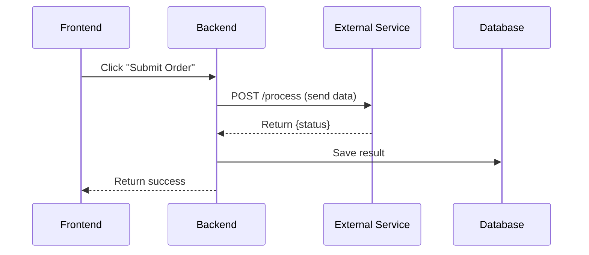
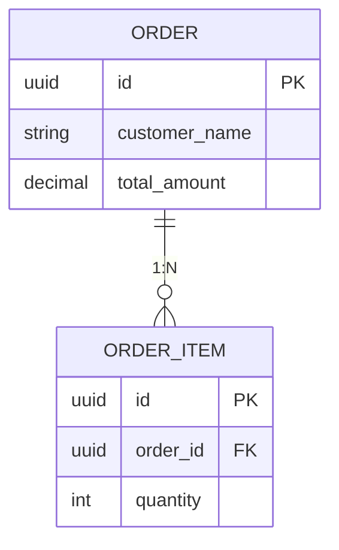
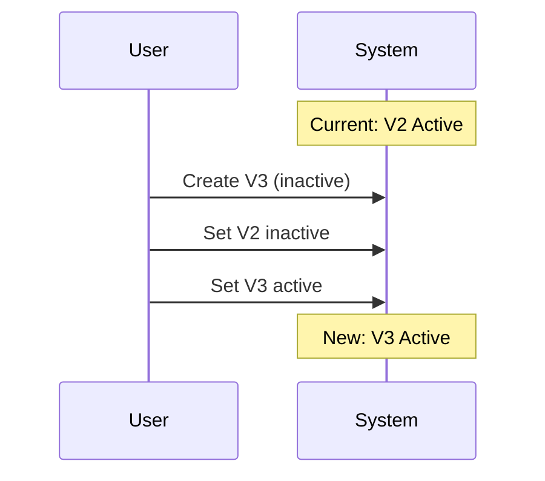

# Meeting Minutes Taker

Transform raw meeting transcripts into comprehensive, evidence-based meeting minutes through iterative review.

## Quick Start

**Pre-processing (Optional but Recommended):**
- **Document conversion**: Use `markdown-tools` skill to convert .docx/.pdf to Markdown first (preserves tables/images)
- **Transcript cleanup**: Use `transcript-fixer` skill to fix ASR/STT errors if transcript quality is poor
- **Context file**: Prepare `context.md` with team directory for accurate speaker identification

**Core Workflow:**
1. Read the transcript provided by user
2. Load project-specific context file if provided by user (optional)
3. **Intelligent file naming**: Auto-generate filename from content (see below)
4. **Speaker identification**: If transcript has "Speaker 1/2/3", identify speakers before generation
5. **Draft and verify**: Draft once, then verify decisions, owners, numbers and quotations against the transcript; use additional independent passes for long/high-stakes material or demonstrated gaps
6. Self-review using [references/completeness_review_checklist.md](references/completeness_review_checklist.md)
7. Present draft to user for human line-by-line review
8. **Cross-AI comparison** (optional): Human may provide output from other AI tools (e.g., Gemini, ChatGPT) - merge to reduce bias
9. Iterate on feedback until human approves final version

### Intelligent File Naming

Auto-generate output filename from transcript content:

**Pattern**: `YYYY-MM-DD-<topic>-<type>.md`

| Component | Source | Examples |
|-----------|--------|----------|
| Date | Transcript metadata or first date mention | `2026-01-25` |
| Topic | Main discussion subject (2-4 words, kebab-case) | `api-design`, `product-roadmap` |
| Type | Meeting category | `review`, `sync`, `planning`, `retro`, `kickoff` |

**Examples:**
- `2026-01-25-order-api-design-review.md`
- `2026-01-20-q1-sprint-planning.md`
- `2026-01-18-onboarding-flow-sync.md`

Reuse an authorized filename/path. If none is supplied, use a descriptive filename within the authorized output scope; ask only about a real naming conflict or material ambiguity.

## Core Workflow

Read [the detailed procedure and examples](EXTENDED.md#section-4) when working on this part of the task.

### Step 1: Read and Analyze Transcript

Analyze the transcript to identify:
- Meeting topic and attendees
- Key decisions with supporting quotes
- Action items with owners
- Deferred items / open questions

### Step 1.5: Speaker Identification (When Needed)

**Trigger**: Transcript only has generic labels like "Speaker 1", "Speaker 2", "发言人1", etc.

**Approach** (inspired by Anker Skill):

#### Phase A: Feature Analysis (Pattern Recognition)

Read [the detailed procedure and examples](EXTENDED.md#section-5) when working on this part of the task.

#### Phase B: Context Mapping (If Context File Provided)

When user provides a project context file (e.g., `context.md`):

1. Load team directory section
2. Match feature patterns to known team members
3. Cross-reference roles with speaking patterns

**Context file should include:**
```markdown
## Team Directory
| Name | Role | Communication Style |
|------|------|---------------------|
| Alice | Backend Lead | Technical, decisive, assigns backend tasks |
| Bob | PM | Product-focused, asks requirements questions |
| Carol | TPM | Process-focused, tracks timeline/resources |
```

#### Phase C: Confirmation Before Proceeding

**CRITICAL**: Never silently assume speaker identity.

Present analysis summary to user:
```
Speaker Analysis:
- Speaker 1 → Alice (Backend Lead) - 80% confidence based on: technical focus, task assignment pattern
- Speaker 2 → Bob (PM) - 75% confidence based on: product questions, requirements discussion
- Speaker 3 → Carol (TPM) - 70% confidence based on: timeline concerns, resource tracking

Please confirm or correct these mappings before I proceed.
```

After user confirmation, apply mappings consistently throughout the document.

### Step 1.7: Transcript Quality Assessment (Optional)

Read [the detailed procedure and examples](EXTENDED.md#section-3) when working on this part of the task.

### Step 2: Draft and Verify Against the Transcript

Draft complete minutes once, then verify decisions, owners, numbers and quotations against the transcript. Use independent passes or available subagents for long/high-stakes material or demonstrated coverage gaps, within host capabilities and task authorization.

#### Optional Independent Review

- Give each reviewer the source transcript and requested coverage, with isolated context when supported.
- Review decisions, action items, numeric details, deferred topics and diagrams against source locations.
- Merge only transcript-supported claims and diagrams; consolidate duplicates.
- Remove unsupported or contradicted items with a review note; agreement between generated drafts is not source evidence.
- Keep intermediate files only within the authorized task output/temp directory. No fixed pass count or specific host `Task` tool is required.

The optional multi-agent/offloading examples in `EXTENDED.md` apply only when this escalation is selected and supported; they do not mandate three drafts for every transcript.

#### Output Requirements

- Follow the user's language preference; otherwise use the transcript language, preserving technical terms
- **Evidence-based decisions** - Every significant decision needs a supporting quote
- **Structured sections** - Executive Summary, Key Decisions, Discussion, Action Items, Parking Lot
- **Proper quote formatting** - See Quote Formatting Requirements section below
- **Mermaid diagrams** (STRONGLY ENCOURAGED) - Visual diagrams elevate minutes beyond pure text:
  - **ER diagrams** for database/schema discussions
  - **Sequence diagrams** for data flow and API interactions
  - **Flowcharts** for process/workflow decisions
  - **State diagrams** for state machine discussions
  - Diagrams make minutes significantly easier for humans to review and understand
- **Context-first document structure** - Place all reviewed artifacts (UI mockups, API docs, design images) at the TOP of the document (after metadata, before Executive Summary) to establish context before decisions; copy images to `assets/<meeting-name>/` folder and embed inline using `` syntax; include brief descriptions with the visuals - this creates "next level" human-readable minutes where readers understand what was discussed before reading the discussion
- **Speaker attribution** - Correctly attribute decisions to speakers

#### Key Rules

- Never assume - Ask user to confirm if unclear
- Quote controversial decisions verbatim
- Use only source-supported owners. Preserve `Speaker N`, a named team, or `owner TBD` when identity or personal assignment is unconfirmed
- Preserve numerical values (ranges, counts, priorities)
- **Verify against the transcript**; use additional independent passes where scope or observed gaps justify them
- **Normalize equivalent terminology** - Treat trivial variations (e.g., "backend architecture" vs "backend", "API endpoint" vs "endpoint") as equivalent; do NOT point out or highlight such differences between speakers
- **Single source of truth** - Place each piece of information in ONE location only; avoid duplicating tables, lists, or summaries across sections (e.g., API list belongs in Discussion OR Reference, not both)

### Step 3: Self-Review for Completeness

After initial generation, immediately review against transcript:

```
Completeness Checklist:
- [ ] All discussion topics covered?
- [ ] All decisions have supporting quotes?
- [ ] All speakers attributed correctly?
- [ ] Action-item owners match the source, with unconfirmed assignments marked TBD?
- [ ] Numerical values preserved (ranges, counts)?
- [ ] Entity relationships captured?
- [ ] State machines complete (all states listed)?
```

If gaps found, add missing content silently without mentioning what was missed.

### Step 4: Present to User for Human Review

Present the complete minutes as a **draft for human review**. Emphasize:
- Minutes require careful line-by-line human review
- Domain experts catch terminology conflicts AI may miss
- Final version emerges through iterative refinement

User may:
- Accept as-is (rare for complex meetings)
- Request deeper review for missing content
- Identify terminology issues (e.g., naming conflicts with existing systems)
- Provide another AI's output for cross-comparison

### Step 5: Cross-AI Comparison (Reduces Bias)

**When human provides output from another AI tool** (e.g., Gemini, ChatGPT, etc.):

This step is valuable because:
- **Different AI models have different biases** - Each AI catches different details
- **Cross-validation** - Content appearing in both outputs is likely accurate
- **Gap detection** - Content in one but not the other reveals potential omissions
- **Error correction** - One AI may catch factual errors the other missed (e.g., wrong date, wrong attendee name)

**Comparison Process:**
1. Read the external AI output carefully
2. Identify items present in external output but missing from our draft
3. Verify each item against original transcript before adding (don't blindly copy)
4. Identify items where external AI has errors (wrong facts) - note but don't copy errors
5. UNION merge valid new content into our draft
6. Document any corrections made based on cross-comparison

**Example findings from cross-AI comparison:**
- Missing decision about API authentication method ✓ (add to our draft)
- Missing naming convention specification ✓ (add to our draft)
- Wrong date (2026-01-13 vs actual 2026-01-14) ✗ (don't copy error)
- Wrong attendee name ✗ (don't copy error)
- Missing database performance concern ✓ (add to parking lot)

### Step 6: Iterate on Human Feedback (Critical)

**When user requests deeper review** ("deep review", "check again", "anything missing"):

1. Re-read transcript section by section
2. Compare each section against current minutes
3. Look for: entities, field names, numerical ranges, state transitions, trade-offs, deferred items
4. Add any omitted content
5. Never claim "nothing missing" without thorough section-by-section review

**When user provides another version to merge:**

Merge Principle: **Source-verified consolidation**

1. Compare claims in each version with the original transcript.
2. Add supported missing details and consolidate duplicates.
3. Preserve useful detail only when source-supported; remove unsupported or contradicted items with a review note.
4. Preserve `Speaker N`, a team, or `owner TBD` where identity/assignment is unconfirmed.
5. Maintain logical section numbering and source locators.

### Diagram Review During Merge

Inventory diagrams from each version, then retain useful, nonduplicative diagrams whose entities, relationships and transitions are supported by the transcript. A generated diagram is a representation to verify, not independent evidence. If a diagram introduces unsupported edges or states, correct or omit it and record the reason. Preserve supported technical detail rather than keeping every generated diagram automatically.

## Output Language

- **Primary:** Match the language of the transcript (or user's preference if specified)
- **Preserve in English:** Technical terms, entity names, abbreviations (standard practice)
- **Quotes:** Keep original language from transcript

## Reference Files

| File | When to Load |
|------|--------------|
| [meeting_minutes_template.md](references/meeting_minutes_template.md) | First generation - Contains template structure |
| [completeness_review_checklist.md](references/completeness_review_checklist.md) | During review steps - Contains completeness checks |
| [context_file_template.md](references/context_file_template.md) | When helping user create context.md - Contains team directory template |
| Project context file (user-provided) | When user provides project-specific context (team directory, terminology, conventions) |

### Recommended Pre-processing Pipeline

**Full pipeline for .docx transcripts:**

```
Step 0: markdown-tools      # Convert .docx → Markdown (preserves tables/images)
        ↓
Step 0.5: transcript-fixer  # Fix ASR errors (optional, if quality is poor)
        ↓
Step 1+: meeting-minutes-taker  # Generate structured minutes
```

**Commands:**
```bash
# 1. Install markitdown (one-time)
uv tool install "markitdown[pdf]"

# 2. Convert .docx to markdown
markitdown "录音转写.docx" -o transcript.md

# 3. Then use meeting-minutes-taker on transcript.md
```

**Benefits of combo workflow:**
- **Tables preserved**: markitdown converts Word tables to Markdown tables
- **Images extracted**: Can be embedded in final minutes
- **Readable corrected text**: preserve the original transcript for quotations; label corrected wording and retain its source locator instead of presenting it as verbatim speech
- **Accurate speaker ID**: Style analysis works better on clean text
- **正交设计**: Each skill does one thing well, composable pipeline

## Common Patterns

### Architecture Discussions → Mermaid Diagrams (Next-Level Minutes)

**Diagrams elevate meeting minutes beyond pure text.** They make complex discussions immediately understandable for human reviewers. Always look for opportunities to add visual diagrams.

#### When to Use Diagrams:
- **Data flow discussions** → Sequence diagram
- **Database schema discussions** → ER diagram
- **Process/workflow decisions** → Flowchart
- **State machine discussions** → State diagram
- **System architecture** → Component diagram

#### Example: Data Flow (Sequence Diagram)



#### Example: Database Schema (ER Diagram)



#### Example: Version Switching (Workflow Diagram)



### Quote Formatting Requirements (CRITICAL)

Quote the original transcript and retain a source locator (timestamp, line or section). Label any corrected wording explicitly; do not silently quote an ASR correction as verbatim speech.

**Quotes MUST use proper markdown blockquote format on separate lines:**

**❌ WRONG: Inline quote format**
```markdown
* **Quote:** > "This is wrong" - **Speaker**
```

**✅ CORRECT: Blockquote on separate lines**
```markdown
* **Quote:**
  > "This is the correct format" - **Speaker**
```

**✅ CORRECT: Multiple quotes**
```markdown
* **Quote:**
  > "First quote from the discussion" - **Speaker1**
  > "Second quote supporting the same decision" - **Speaker2**
```

**Key formatting rules:**
- `* **Quote:**` on its own line (no quote content on this line)
- Blank line NOT needed after `* **Quote:**`
- Quote content indented with 2 spaces, then `> ` prefix
- Speaker attribution at end of quote line: `- **SpeakerName**`
- Multiple quotes use same indentation, each on its own line

### Technical Decisions → Decision Block

```markdown
### 2.X [Category] Decision Title

* **Decision:** Specific decision made
* **Logic:**
  * Reasoning point 1
  * Reasoning point 2
* **Quote:**
  > "Exact quote from transcript" - **Speaker Name**
```

### Deferred Items → Parking Lot

Items with keywords like "defer to later", "Phase 2", "not in MVP" go to Parking Lot with context.

## Human-in-the-Loop Iteration (Essential)

Meeting minutes are **not one-shot outputs**. High-quality minutes emerge through multiple review cycles:

### Why Human Review is Critical

1. **Terminology conflicts**: Humans know existing system naming (e.g., "Note" already means comments in the existing system)
2. **Domain context**: Humans catch when a term could be confused with another (e.g., "UserProfile" vs "Account")
3. **Organizational knowledge**: Humans know team conventions and prior decisions
4. **Completeness gaps**: Humans can request "deep review" review when something feels missing

### Example Iteration Pattern

```
Round 1: Initial generation
  └─ Human review: "Check original transcript for missing items"
Round 2: Deep transcript review, add omitted content
  └─ Human review: "UserProfile conflicts with existing Account entity naming"
Round 3: Update terminology to use "CustomerProfile" instead
  └─ Human review: "Note field conflicts with existing Comment system"
Round 4: Update to use "Annotation" instead of "Note"
  └─ Human approval: Final version ready
```

### Key Principle

**The AI generates the first draft; humans refine to the final version.** Never assume the first output is complete or uses correct terminology. Always encourage human review and be ready for multiple iteration cycles.

## Anti-Patterns

- ❌ Delivering an unchecked draft without verifying it against the transcript
- ❌ Splitting review scope without checking cross-section decisions and dependencies
- ❌ Repeating complete drafts without using source evidence to resolve differences
- ❌ Generic summaries without supporting quotes
- ❌ Inventing a personal owner when the source assigns only a team or leaves ownership open
- ❌ Missing numerical values (priorities, ranges, state counts)
- ❌ State machines with incomplete states
- ❌ Circular debate transcribed verbatim instead of summarized
- ❌ Removing source-supported detail during multi-version consolidation without checking coverage
- ❌ Claiming "nothing missing" without section-by-section review
- ❌ Treating first draft as final without human review
- ❌ Using terminology without checking for conflicts with existing systems
- ❌ Shared context between subagents (causes cross-contamination and missed content)
- ❌ Keeping all intermediate outputs in conversation context (causes token overflow, use file system)
- ❌ **Pure text minutes without diagrams** - Architecture/schema discussions deserve visual representation
- ❌ **Deleting intermediate files after merge** - Preserve for human review and debugging
- ❌ **Blindly copying external AI output** - Always verify against transcript before merging
- ❌ **Ignoring cross-AI comparison opportunity** - Different AI models catch different details
- ❌ Assuming a particular subagent tool or parallel execution is required in every host
- ❌ **Flat intermediate directory** - MUST use transcript-specific subdirectory `intermediate/<transcript-name>/` to avoid conflicts
- ❌ **Inline quote formatting** - Quotes MUST use blockquote format on separate lines, not inline `> "quote"`
- ❌ Retaining unsupported diagrams, or dropping unique source-supported relationships without review
- ❌ **Highlighting trivial terminology variations** - Do NOT point out differences like "backend architecture" vs "backend" or "API" vs "endpoint" between speakers; these are equivalent terms and highlighting such differences is disrespectful
- ❌ **Duplicate content across sections** - Do NOT repeat the same information in multiple sections (e.g., API endpoint table in both "Discussion" and "Reference"); place content in ONE authoritative location and reference it if needed
- ❌ **Creating non-existent links** - Do NOT create markdown links to files that don't exist in the repo (e.g., `[doc.md](reviewed-document)`); use plain text for external/local documents not in the repository
- ❌ **Losing content during consolidation** - When moving or consolidating sections, verify ALL bullet points and details are preserved; never summarize away specific details like "supports batch operations" or "button triggers auto-save"
- ❌ **Appending domain details to role titles** - Use ONLY the Role column from Team Directory for speaker attribution (e.g., "Backend", "Frontend", "TPM"); do NOT append specializations like "Backend, Infrastructure" or "Backend, Business Logic" - all team members with the same role should have identical attribution
